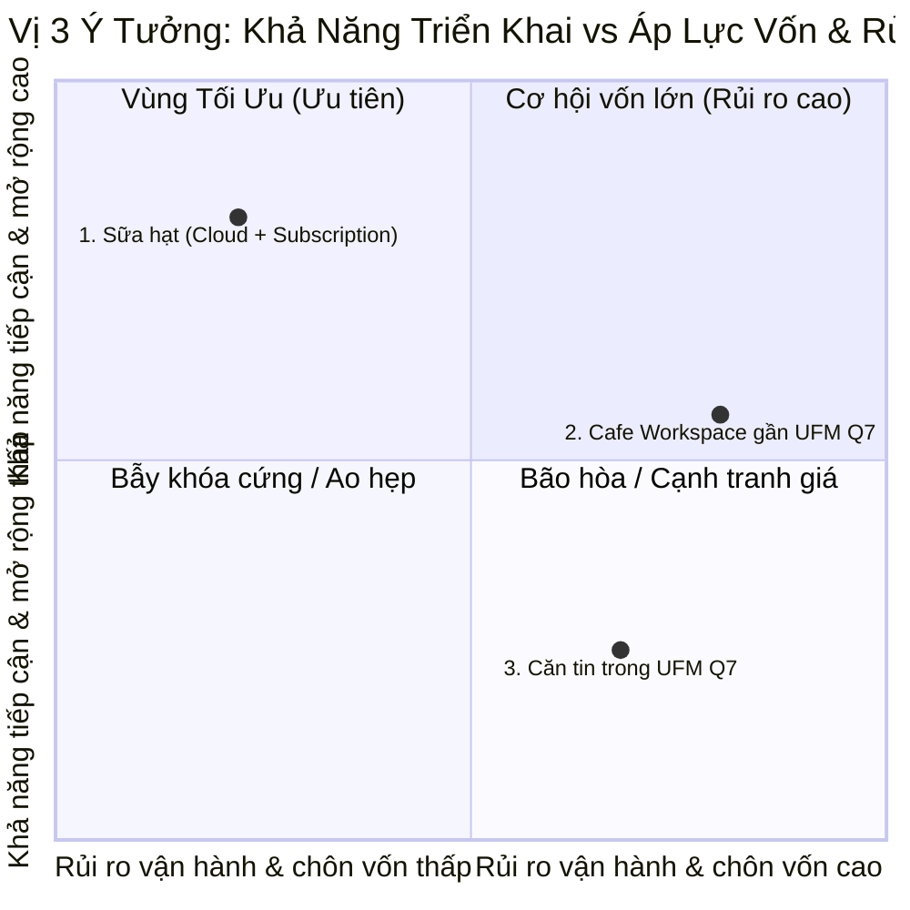

# Báo Cáo Nghiên Cứu Thị Trường & Đánh Giá Cơ Hội Kinh Doanh Quanh UFM Quận 7 (TP.HCM)

**Đối tượng so sánh:** (1) Kinh doanh Sữa hạt · (2) Quán Cafe (Workspace) gần UFM Quận 7 · (3) Căn tin trong UFM Quận 7  
**Khu vực trọng tâm:** Cơ sở Tân Thuận – 27 Tân Mỹ, P. Tân Thuận (P. Tân Thuận Tây cũ), Quận 7, TP.HCM & vùng lân cận bán kính 1–3 km  
**Ngày báo cáo:** 12/11/2026 · **Đơn vị tiền tệ:** VND (tỷ giá quy đổi tham khảo: 1 USD = 25.000 VND `[ESTIMATE]`)

---

> ## Executive Verdict (Kết Luận Cốt Lõi)
>
> 1. **Idea tiềm năng nhất (Xếp hạng #1 — 71,0/100 điểm): KINH DOANH SỮA HẠT**, **VỚI ĐIỀU KIỆN ĐỊNH VỊ BẮT BUỘC**: Không mở quán mặt tiền đường lớn chỉ để bán lẻ cho sinh viên UFM, mà vận hành theo mô hình **Bếp trung tâm / Cloud Kitchen (vốn 15–25 triệu VND) tại khu Tân Mỹ** kết hợp **Pre-order gói tuần (Zalo OA) + giao sáng cho cư dân/mẹ bầu Phú Mỹ Hưng, dân văn phòng & bệnh viện (FV/Tâm Đức/Q.7) + bỏ sỉ B2B cho các quán cafe/gym quanh Quận 7**.
> 2. **Tại sao Sữa hạt thắng trên góc độ hiệu quả vốn & rủi ro?** Doanh thu năm 1 bảo thủ–cơ sở khiêm tốn hơn (`823,6 triệu VND/năm` ~ `68,6 triệu/tháng`) `[ESTIMATE]`, nhưng **lợi nhuận dương ngay cả trong kịch bản Xấu (`+7,3 triệu/tháng`)**, hoàn vốn dự kiến **`1,1–3,0 tháng`**, cưỡi sóng tăng trưởng cấu trúc **`~9,5%–14%/năm`** của ngành sữa hạt `[FACT]`, và **miễn nhiễm** trước hai rủi ro chí mạng tại UFM Q.7 là *giá mặt bằng đắt đỏ* và *việc UFM chuyển phần lớn sinh viên chính quy về cơ sở Long Trường (Thủ Đức)*.
> 3. **Xếp hạng #2 (58,5/100 điểm) — Quán Cafe (Workspace) gần UFM Q.7:** Có thị trường phục vụ khả dụng lớn nhất (`~69,8 tỷ VND/năm`) `[ESTIMATE]`, nhưng đang đối mặt **rủi ro vỡ dòng tiền cao nhất**: CAPEX nặng (`300 triệu – 1 tỷ VND`), giá thuê quanh Tân Mỹ/Lâm Văn Bền cao (`25–90 triệu/tháng`) `[FACT]`, đối thủ dày đặc (Neru 24/7, Chốn Riêng 30k/4h, Góc UFM', Bamos 24/7, Highlands, Phúc Long) `[FACT]`, và làn sóng thanh lọc F&B (`>50.000` quán đóng cửa trong 6T/2025) `[FACT]`. Trong kịch bản thận trọng (`105,9 triệu/tháng`), mô hình này **lỗ `-4,7 triệu/tháng`** `[ESTIMATE]`.
> 4. **Xếp hạng #3 (52,5/100 điểm) — Căn tin trong UFM Q.7 (27 Tân Mỹ):** Doanh thu 1 đơn vị thầu trọn lớn (`~2,92 tỷ VND/năm` ~ `243 triệu/tháng`) `[ESTIMATE]`, nhưng **không phải thị trường mở để tự ý khởi nghiệp**: bị khóa bởi chu kỳ đấu thầu/đấu giá tài sản công `3–5 năm`, vướng quy định giá trần sinh viên, hụt cầu mùa hè/Tết, cạnh tranh sát cổng với Chợ Tân Mỹ, và chịu xu hướng thu hẹp tỷ trọng sinh viên nội thành khi UFM đẩy mạnh campus `78.000 m²` tại Long Trường (Thủ Đức) `[FACT]`. *(Chỉ phù hợp nếu bạn là nhà thầu bếp công nghiệp có sẵn pháp nhân và đúng đợt UFM mời thầu mới).*

---

## 1. Phạm Vi, Bối Cảnh Thực Địa UFM Quận 7 & Phương Pháp Nghiên Cứu

### 1.1. Bối cảnh thực địa Cơ sở UFM Quận 7 (Phát hiện then chốt)
- **Vị trí thực tế hiện nay:** Cơ sở cũ tại `2/4 Trần Xuân Soạn` đã ngừng hoạt động giảng dạy và được thay thế bằng **Cơ sở Tân Thuận tại số 27 Tân Mỹ, P. Tân Thuận (P. Tân Thuận Tây cũ), Quận 7, TP.HCM** `[FACT: ufm.edu.vn, edu2review.com]`.
- **Quy mô hạ tầng tại 27 Tân Mỹ:** Tổng diện tích **`9.160 m²`** gồm **`105 phòng`** (giảng đường, Hội trường A701, Trung tâm Ngoại ngữ - Tin học A.105, Trạm Y tế B.101 và Khối nhà B có **`32 phòng` ký túc xá** nội trú sức chứa giới hạn hơn 100 chỗ mỗi đợt tuyển mới, phí KTX `~500.000 VND/tháng`) `[FACT: ufm.edu.vn]`.
- **Biến số dịch chuyển cơ cấu sinh viên (Rủi ro cầu nội khu):** Toàn UFM đón **`4.000+` tân sinh viên khóa 23D (2023–2024)** và **`6.268+` tân sinh viên chính quy khóa 25D (2025–2026)** `[FACT: tapchikinhtetaichinh.vn, thoibaotaichinhvietnam.vn]`. Tuy nhiên, từ năm 2023–2024 UFM đã vận hành **Cơ sở Long Trường (`306 Võ Văn Hát, TP. Thủ Đức`, quy mô gần `78.000 m²`)** và dồn phần lớn sinh viên chính quy năm nhất cùng đào tạo tập trung về Thủ Đức `[FACT: ufm.edu.vn, edu2review.com]`. Cơ sở 27 Tân Mỹ chủ yếu đảm nhận một số chương trình đặc thù/chất lượng cao/tiếng Anh toàn phần, học phần chuyên ngành và trung tâm ngoại ngữ–tin học `[FACT: ufm.edu.vn]`.
- **Hệ sinh thái khách hàng bao quanh 27 Tân Mỹ (bán kính 0,5–3,5 km):**
  - Ngay sát cổng: **Chợ Tân Mỹ** & **Chung cư Tân Mỹ (`500–700m`)** `[FACT: moovitapp.com]`.
  - Cách `1–1,5 km`: **Khu đô thị Phú Mỹ Hưng** với **`30.000–40.000` cư dân** (hơn 50% là chuyên gia/cộng đồng Hàn Quốc, Nhật Bản, Đài Loan có sức mua cao) và **hàng chục ngàn nhân viên văn phòng** tại khu Thương mại Tài chính Quốc tế `[FACT: phumyhungcorp.com.vn, wikipedia.org]`.
  - Cách `0,8–2,5 km`: **Bệnh viện Quận 7 (`0,8–1,2 km`)**, **Viện Tim Tâm Đức & Bệnh viện FV (`2–2,5 km`)**.
  - Cách `1,5–4 km`: **ĐH Tôn Đức Thắng (`1,5–2 km`)**, **ĐH Cảnh sát Nhân dân (`2–3 km`)**, **ĐH RMIT (`3–4 km`)** và **KCX Tân Thuận (`2–3,5 km`, `56.000–60.000` lao động)** `[FACT: dantri.com.vn, vnexpress.net]`.

### 1.2. Phương pháp luận & Quy chuẩn thẩm định
- Kết hợp nguồn dữ liệu ngành Việt Nam (iPOS.vn, Euromonitor, Ken Research, IMARC, Vietstock, Báo Đấu thầu, cổng thông tin UFM, khảo sát giá thuê mặt bằng thực tế tại Quận 7 & các sàn ShopeeFood/GrabFood).
- Định lượng **TAM / SAM / SOM** theo cả hai phương pháp **Top-Down** và **Bottom-Up**, kiểm tra sai số đối chiếu qua script `tam_calculator.mjs` với 3 kịch bản (`Conservative 0.65x / Base 1.0x / Optimistic 1.4x`).
- Mọi dữ liệu được gắn nhãn nghiêm ngặt: **`[FACT]`** (nguồn thứ cấp/sơ cấp có dẫn chứng), **`[ESTIMATE]`** (giả định mô hình hóa có công thức minh bạch), **`[UNVERIFIED]`** (giả thuyết cần kiểm chứng thực địa).

---

## 2. Chấm Điểm Cơ Hội & Xếp Hạng Trực Diện 3 Ý Tưởng (Niche Scorecard)

Áp dụng khung chấm điểm **100 điểm** theo 6 tiêu chí trọng số của chuẩn `market-trend-niche` (Thang 1 = rất bất lợi, 10 = cực kỳ thuận lợi):

| Tiêu chí đánh giá | Trọng số | Idea 1: Sữa hạt (Cloud Kitchen + Pre-order/B2B) | Idea 2: Cafe Workspace gần UFM Q.7 | Idea 3: Căn tin trong UFM Q.7 (27 Tân Mỹ) |
| :--- | :---: | :---: | :---: | :---: |
| **1. Tính cấp thiết & Tần suất nhu cầu** | **25%** | **6/10** (1,50) — Tốt với văn phòng/mẹ bầu/gym, nhưng không thiết yếu bằng bữa cơm với SV | **7/10** (1,75) — Gen Z đi cafe 3–4 lần/tuần `[FACT]`, nhưng dễ thay thế bằng ở nhà/thư viện | **8/10** (2,00) — Bữa ăn sáng/trưa thiết yếu mỗi ngày học, nhưng bị giảm bởi lịch nghỉ hè & Chợ Tân Mỹ |
| **2. Sức chi trả & Biên lợi nhuận gộp** | **20%** | **8/10** (1,60) — Biên gộp `50–70%`, combo tuần/1L AOV `60–110k` tại PMH `[FACT/EST]` | **7/10** (1,40) — Biên gộp nước `75–80%`, nhưng bị ăn mòn bởi "khách ngồi đồng" 4–6h & tiền thuê mặt bằng | **5/10** (1,00) — Bị khống chế giá trần sinh viên (`25–40k/suất`, nước `5–20k`), biên ròng `12–18%` `[FACT/EST]` |
| **3. Khoảng trống cạnh tranh (White Space)** | **20%** | **7/10** (1,40) — Đã có 4–5 shop trên app & sữa hộp, nhưng thiếu thương hiệu sữa hạt tươi giao sáng theo liệu trình cá nhân tại trục Tân Mỹ–PMH | **4/10** (0,80) — Rất chật: Neru 24/7, Chốn Riêng (30k/4h), Góc UFM', Bamos 24/7, Highlands, Phúc Long, Komune vây kín `[FACT]` | **6/10** (1,20) — Độc quyền nội khu nếu trúng thầu, nhưng đối mặt đơn vị hiện hữu & hàng quán Chợ Tân Mỹ |
| **4. Khả năng tiếp cận kênh phân phối** | **15%** | **8/10** (1,20) — Triển khai nhanh qua Zalo OA, hội nhóm cư dân PMH, ShopeeFood/GrabFood, gửi mẫu thử gym/văn phòng | **6/10** (0,90) — Phụ thuộc hoàn toàn vào tìm được mặt bằng giá hợp lý & luồng khách vãng lai/TikTok Maps | **3/10** (0,45) — Bị khóa bởi cổng **đấu thầu/đấu giá tài sản công** chu kỳ `3–5 năm`; không thể tự mở để thử nghiệm nhỏ `[FACT]` |
| **5. Dễ dàng pháp lý & Vận hành** | **10%** | **6/10** (0,60) — Cần kiểm nghiệm & tự công bố NĐ 15 (`1,5–3,5tr/mẫu`) `[FACT]`; vận hành rủi ro ở hạn dùng `2–3 ngày` | **5/10** (0,50) — Vận hành nặng: CAPEX `300tr–1 tỷ`, PCCC, nhân sự 3 ca, điện máy lạnh, bão đóng cửa TP.HCM `>11%` `[FACT]` | **3/10** (0,30) — Pháp lý đấu thầu phức tạp, bếp 1 chiều, kiểm soát VSATTP nghiêm ngặt của trường & y tế `[FACT]` |
| **6. Thời điểm & Động lực xu hướng (Why Now)** | **10%** | **8/10** (0,80) — Sữa hạt cao cấp tăng `~14%/năm` `[FACT]`, xu hướng healthy/low-sugar 2025–2027 tăng mạnh tại đô thị | **5/10** (0,50) — Xu hướng cafe làm việc vẫn có, nhưng thị trường F&B đang thanh lọc mạnh (`>50.000` quán đóng H1/2025) `[FACT]` | **3/10** (0,30) — Ngược gió tại riêng cơ sở 27 Tân Mỹ do UFM dồn trọng tâm sang campus Long Trường Thủ Đức `[FACT]` |
| **TỔNG ĐIỂM TRỌNG SỐ** | **100%** | **71,0 / 100 (HẠNG 1)** | **58,5 / 100 (HẠNG 2)** | **52,5 / 100 (HẠNG 3)** |

---

## 3. Quy Mô Thị Trường (TAM / SAM / SOM) & Bài Toán Tài Chính 3 Kịch Bản

Tất cả phép tính dưới đây được chạy trực tiếp bằng script kiểm định `tam_calculator.mjs` (đơn vị chuẩn: **triệu VND/năm**, kèm quy đổi tỷ VND để đối chiếu).

### 3.1. Tổng hợp Dual-Method Market Sizing (Top-Down vs. Bottom-Up)

| Chỉ số (triệu VND/năm) | Idea 1: Sữa hạt (Trục Tân Mỹ – PMH 3km) | Idea 2: Cafe Workspace (Bán kính 2km quanh UFM Q.7) | Idea 3: Căn tin nội khu UFM Q.7 (27 Tân Mỹ) |
| :--- | :---: | :---: | :---: |
| **TAM (Top-Down)** `[FACT]` | **5.110.500** (`5.110,5 tỷ` — Sữa thực vật VN 2025, Euromonitor) | **118.000.000** (`118.000 tỷ` — Ngành đồ uống VN 2024, iPOS) | **73.920** (`73,92 tỷ` — Chi tiêu F&B nội khu toàn UFM TP.HCM) `[EST]` |
| **SAM (Top-Down)** `[EST]` | **40.884** (`40,88 tỷ`, `0,8%` TAM tại cụm Q.7/PMH) | **70.800** (`70,80 tỷ`, `0,06%` TAM cho cụm Workspace 2km) | **5.322,24** (`5,32 tỷ`, `7,2%` tỷ trọng cơ sở 27 Tân Mỹ) |
| **SAM (Bottom-Up)** `[EST]` | **41.472** (`120.000` người × `15%` ICP × `2,304 tr/năm`) | **68.796** (`45.000` người × `35%` ICP × `4,368 tr/năm`) | **5.292** (`3.500` người × `45%` mua nội khu × `3,36 tr/năm`) |
| **Sai lệch TD vs BU** | **`+1,4%`** (Khớp rất cao) | **`-2,8%`** (Khớp rất cao) | **`-0,6%`** (Khớp rất cao) |
| **Blended Base SAM** | **41.178 triệu** (`41,18 tỷ VND/năm`) | **69.798 triệu** (`69,80 tỷ VND/năm`) | **5.307,12 triệu** (`5,31 tỷ VND/năm`) |
| **Tăng trưởng (CAGR 3 năm)** | **`9,5%/năm`** (nhóm cao cấp `~14%`) `[FACT]` | **`5,5%/năm`** (theo tăng trưởng F&B 2025) `[FACT]` | **`3,0%/năm`** (bị kìm bởi dịch chuyển Thủ Đức) `[EST]` |
| **SOM Năm 1 — Conservative (0,65×)** | **535,3 triệu** (`44,6 tr/tháng`) | **1.270,3 triệu** (`105,9 tr/tháng`) | **1.897,3 triệu** (`158,1 tr/tháng`) |
| **SOM Năm 1 — Base (1,0×)** | **823,6 triệu** (`68,6 tr/tháng`, `2,0%` SAM) | **1.954,3 triệu** (`162,9 tr/tháng`, `2,8%` SAM) | **2.918,9 triệu** (`243,2 tr/tháng`, `55%` SAM nếu thầu trọn) |
| **SOM Năm 1 — Optimistic (1,4×)** | **1.153,0 triệu** (`96,1 tr/tháng`) | **2.736,1 triệu** (`228,0 tr/tháng`) | **4.086,5 triệu** (`340,5 tr/tháng`) |

> **Diễn giải công thức Bottom-Up `[ESTIMATE]`:**
> - **Idea 1 (Sữa hạt):** Vùng bán kính 3 km quanh 27 Tân Mỹ có khoảng `120.000` người trưởng thành (loại trùng lặp giữa `30–40k` dân Phú Mỹ Hưng, `56–60k` lao động KCX Tân Thuận, hàng chục ngàn NVVP PMH, dân cư Tân Thuận Tây/Tân Phú và SV UFM/TDT/RMIT). Nhóm ICP uống định kỳ chiếm `15%` (`18.000` người), tiêu thụ bình quân `6 chai/tháng × 12 tháng × 32.000đ = 2,304 triệu VND/năm`.
> - **Idea 2 (Cafe Workspace):** Bán kính 2 km quanh 27 Tân Mỹ ước tính `45.000` SV/freelancer/NVVP thường xuyên hiện diện, `35%` (`15.750` người) có nhu cầu học/làm việc tại quán cafe với tần suất `2 lần/tuần × 42 tuần hiệu quả = 84 lượt/năm × 52.000đ/lượt = 4,368 triệu VND/năm`.
> - **Idea 3 (Căn tin UFM Q.7):** Ước tính khoảng `3.500` lượt SV/học viên TT Ngoại ngữ-Tin học/GV luân phiên có mặt tại 27 Tân Mỹ (`120` ngày đến trường/người/năm), `45%` chi tiêu ăn uống tại căn tin thay vì ra Chợ Tân Mỹ, bình quân `28.000đ/ngày đến trường = 3,36 triệu VND/năm`.

### 3.2. Mô phỏng Hiệu Quả Tài Chính & Điểm Gãy Rủi Ro (Unit Economics Stress Test `[ESTIMATE]`)

Các giả định chi phí bám sát benchmark thực tế TP.HCM (trước thuế TNDN/TNCN và khấu hao tài sản cố định):
- **Idea 1 (Sữa hạt Cloud Kitchen):** Vốn ban đầu **22 triệu VND** (máy xay/nấu + tủ mát + bao bì `15tr`, kiểm nghiệm & tự công bố NĐ 15 `3,5tr`, dự phòng `3,5tr`). Mặt bằng `0đ` (tận dụng bếp nhà/trọ quanh Tân Mỹ), COGS `35%`, nhân sự phụ bếp/đóng gói + điện nước `15tr/tháng` (chủ trực tiếp vận hành), chiết khấu app/hỗ trợ ship/ads `15%` doanh thu.
- **Idea 2 (Cafe Workspace `120 m²`):** Vốn ban đầu **500 triệu VND** (trong dải `300tr–1 tỷ` `[FACT]`). Thuê mặt bằng Q.7 `38tr/tháng` (`~23%` doanh thu Base), nhân sự `32tr/tháng`, điện điều hòa/Wi-Fi 6 `12tr/tháng`, COGS `22%`, marketing/POS `5%`.
- **Idea 3 (Căn tin UFM Q.7 thầu trọn):** Vốn ban đầu **300 triệu VND** (trong dải `200–500tr+` gồm bếp 1 chiều + ký quỹ `3–6` tháng `[FACT]`). Phí thuê/giao khoán bình quân `15tr/tháng`, nhân sự bếp/phục vụ `55tr/tháng`, điện/nước/gas/rác `15tr/tháng`, COGS `45%`, chi phí khác `1%`.

| Kịch bản | Chỉ số tháng (triệu VND) | Idea 1: Sữa hạt | Idea 2: Cafe Workspace | Idea 3: Căn tin UFM Q.7 |
| :--- | :--- | :---: | :---: | :---: |
| **Conservative (`0,65×`)** | Doanh thu / tháng | `44,6` | `105,9` | `158,1` |
| | **EBITDA / tháng (Biên %)** | **`+7,3` (`+16,4%`)** | **`-4,7` (`-4,5%` — LỖ)** | **`+0,4` (`+0,2%` — Hòa vốn mỏng)** |
| | Thời gian hoàn vốn CAPEX | **`3,0 tháng`** | *Không hoàn vốn (âm dòng tiền)* | *Gần như không hoàn vốn* |
| **Base (`1,0×`)** | Doanh thu / tháng | `68,6` | `162,9` | `243,2` |
| | **EBITDA / tháng (Biên %)** | **`+19,3` (`+28,1%`)** | **`+36,9` (`+22,6%`)** | **`+46,4` (`+19,1%`)** |
| | Thời gian hoàn vốn CAPEX | **`1,1 tháng`** *(tính từ lúc đạt steady-state)* | **`13,6 tháng`** | **`6,5 tháng`** |
| **Optimistic (`1,4×`)** | Doanh thu / tháng | `96,1` | `228,0` | `340,5` |
| | **EBITDA / tháng (Biên %)** | **`+33,0` (`+34,4%`)** | **`+84,4` (`+37,0%`)** | **`+98,9` (`+29,0%`)** |
| | Thời gian hoàn vốn CAPEX | **`0,7 tháng`** | **`5,9 tháng`** | **`3,0 tháng`** |

```mermaid
xychart-beta
    title "So Sánh EBITDA Tháng Theo 3 Kịch Bản (Triệu VND/tháng)"
    x-axis ["Conservative (Xấu)", "Base (Cơ sở)", "Optimistic (Tốt)"]
    y-axis "EBITDA (triệu VND)" -10 --> 105
    bar [7.3, 19.3, 33.0]
    bar [-4.7, 36.9, 84.4]
    bar [0.4, 46.4, 98.9]
```

*(Thứ tự cột theo từng nhóm: Cột 1 = Sữa hạt · Cột 2 = Cafe Workspace · Cột 3 = Căn tin UFM Q.7. Có thể thấy Sữa hạt là mô hình DUY NHẤT có đệm an toàn dương rõ rệt ở kịch bản Xấu với rủi ro vốn chỉ `22 triệu VND`).*

---

## 4. Phân Tích Vĩ Mô (PESTEL) & Cấu Trúc Ngành (Porter's Five Forces)

### 4.1. PESTEL Thực Địa Tại TP.HCM & Quận 7 (2025–2027)
- **Pháp lý & Thuế (Political/Legal):**
  - *Sữa hạt:* Nghị định 15/2018/NĐ-CP bắt buộc thực phẩm bao gói sẵn phải **kiểm nghiệm an toàn thực phẩm (`1,5–3,5 triệu VND/mẫu` tại đơn vị chuẩn ISO 17025)** và **tự công bố sản phẩm** trước khi bán `[FACT: giayphepthucpham.vn]`. Năm 2025–2026 cơ quan quản lý siết mạnh hóa đơn điện tử và chuẩn hóa thuế hộ kinh doanh `[FACT: ipos.vn]`.
  - *Căn tin UFM:* Chịu chi phối kép bởi **Luật Quản lý, sử dụng tài sản công 2017 (Điều 55–57)**, **Luật Giáo dục ĐH 2018**, **Luật Đấu thầu** và **NĐ 151/2017/NĐ-CP** (cùng các sửa đổi 2024–2025): bắt buộc lập đề án/đấu giá hoặc đấu thầu công khai, khống chế giá trần và kiểm tra VSATTP gắt gao `[FACT: thuvienphapluat.vn, giaoduc.net.vn]`.
  - *Cafe Workspace:* Yêu cầu tuân thủ **PCCC**, đăng ký kinh doanh và hóa đơn điện tử khi thuê mặt bằng thương mại `[FACT: chothuenha.com.vn]`.
- **Kinh tế (Economic):** Doanh thu F&B Việt Nam 2025 vẫn tăng `5,5%` lên `726.500 tỷ VND`, nhưng người tiêu dùng rơi vào trạng thái **thắt chặt chi tiêu, đề cao "giá trị thực tế"** (Barbell Economy: hoặc rất rẻ `<29k`, hoặc đáng tiền hẳn) `[FACT: ipos.vn]`. Giá thuê mặt bằng tại đô thị lớn chiếm tới **`25–55%` doanh thu** và giá cà phê nhân lập đỉnh khiến **`>50.000` điểm bán F&B đóng cửa trong H1/2025** `[FACT: ipos.vn, cafef.vn]`. Ngược lại, khu vực Phú Mỹ Hưng cách 27 Tân Mỹ chỉ `1–1,5 km` là túi cầu thu nhập cao bền vững nhất Nam Sài Gòn `[FACT]`.
- **Xã hội (Social):** Gen Z TP.HCM đi cafe `3–4 lần/tuần` để làm việc/học tập `[FACT]`, nhưng sinh viên UFM Q.7 nhạy cảm về giá (`15–35k`) và có kỳ nghỉ hè `2,5–3 tháng`. Trong khi đó, xu hướng **không dung nạp lactose, ăn chay, eat clean, giảm đường** thúc đẩy nhóm mẹ bầu, gym, dân văn phòng chuyển sang sữa hạt cao cấp `[FACT: vinaorganic.com, vietstock.vn]`.
- **Công nghệ & Giao vận (Technological):** Thanh toán **VietQR** và đặt hàng **Zalo OA / ShopeeFood / GrabFood** đã phổ cập 100% tại Q.7; tuy nhiên app giao đồ ăn thu chiết khấu **`20–25%`** + phí dịch vụ/đơn nhỏ khiến bán lẻ 1 chai sữa hạt qua app khó có lãi nếu không gom combo hoặc chuyển về kênh Zalo trực tiếp `[FACT: shopeefood.vn, pos365.vn]`.

### 4.2. Porter's Five Forces Scorecard (1 = Rất thuận lợi · 5 = Áp lực khốc liệt)

| Áp lực ngành | Idea 1: Sữa hạt (Q.7/PMH) | Idea 2: Cafe Workspace Q.7 | Idea 3: Căn tin UFM Q.7 |
| :--- | :---: | :---: | :---: |
| **1. Nguy cơ gia nhập mới** | **4/5** (Công thức dễ học, nhiều bếp nhà online mở nhanh) | **4/5** (Rào cản thương hiệu thấp, nhưng vốn lớn `300tr–1 tỷ` lọc bớt người mới) | **2/5** (Rất khó chen chân nếu bạn đã trúng thầu hợp đồng 3–5 năm) |
| **2. Quyền lực người mua** | **3/5** (Khách PMH ưu tiên chất lượng/sạch hơn giá rẻ, dễ trung thành nếu ngon & đúng giờ) | **4/5** (Sinh viên nhạy cảm giá, sẵn sàng chuyển quán nếu quán kia rẻ hơn/rộng hơn `5k`) | **4/5** (Sinh viên bị giới hạn chi tiêu `25–40k`, dễ bỏ ra Chợ Tân Mỹ nếu đồ ăn chán/nóng) |
| **3. Quyền lực nhà cung cấp** | **3/5** (Hạt nhập khẩu óc chó/hạnh nhân phụ thuộc tỷ giá, nhưng dễ đổi sỉ hạt) | **3/5** (Chủ nhà mặt bằng Q.7 giữ thế thượng phong: cọc 2–3 tháng, hợp đồng 3–5 năm `[FACT]`) | **3/5** (Nguyên liệu thực phẩm tươi biến động giá + phụ thuộc Ban quản lý trường) |
| **4. Đe dọa sản phẩm thay thế** | **3/5** (Sữa hộp Vinamilk/TH/Veyo `9–14k/hộp` & máy làm sữa hạt tại nhà) `[FACT]` | **4/5** (Thư viện trường, KTX, học online ở nhà, cafe take-away dưới `29k`) | **5/5** (Cơm bình dân/trà sữa Chợ Tân Mỹ cách vài bước chân, app giao tận cổng) `[FACT]` |
| **5. Cạnh tranh nội bộ ngành** | **3/5** (Có ~5 tiệm địa phương trên app Q.7 nhưng quy mô nhỏ, chưa có brand subscription mạnh) | **5/5** (Độ đặc quán cafe/study cafe quanh Tân Mỹ – Lâm Văn Bền cực cao) | **3/5** (Cạnh tranh lúc đấu thầu khốc liệt, sau trúng thầu thì ổn định nội bộ) |
| **ĐIỂM ÁP LỰC TRUNG BÌNH** | **3,2 / 5 (Dễ thở nhất)** | **4,0 / 5 (Khốc liệt nhất)** | **3,4 / 5 (Bị khóa cửa vào)** |

---

## 5. Phân Tích Đối Thủ Cạnh Tranh & Khoảng Trống Thị Trường

### 5.1. Ma trận đối thủ thực tế quanh 27 Tân Mỹ, Quận 7 `[FACT]`

| Mô hình | Tên đối thủ | Vị trí / Kênh | Khoảng giá (VND) | Điểm mạnh cốt lõi | Điểm yếu / Khe hở khai thác |
| :--- | :--- | :--- | :--- | :--- | :--- |
| **Sữa hạt** | **Selove Milk / Sữa Hạt 10/10 / Shanti Smile / Dì Thanh / SoNut** | Q.7 (Phạm Thái Bường, Tân Quy) · ShopeeFood / GrabFood | `25.000–45.000` / 330–500ml; `60.000–110.000` / 1L | Có đánh giá sẵn trên app, vị trí nội khu Q.7 | Bán rời từng chai trên app (bị phí ship `15–25k` + phí sàn), ít tập trung gói liệu trình sáng sớm theo macro dinh dưỡng (High-protein / Không đường cho mẹ bầu & gym) |
| **Sữa hạt** | **TH true NUT / Vinamilk 9 loại hạt / Vinasoy Veyo / Oatside** | Siêu thị, WinMart+, Circle K, Shopee Mall | `35.000–55.000` / lốc 4×180ml; Oatside `65–110k` / 1L | Rẻ, hạn dùng dài nhiều tháng, tiện trữ tại văn phòng | Có chất ổn định/hương liệu/tiệt trùng UHT, không có cảm giác tươi mới thủ công 100% nguyên chất |
| **Cafe Workspace** | **Neru Coffee 24/7** | Số 4 Đường số 1, khu Tân Mỹ, Q.7 | `30.000–65.000` | Mở 24/7, tích hợp Sleep Box, chia khu phòng lạnh/sân vườn ngay khu Tân Mỹ | Cuối tuần/đêm khuya dễ ồn ở khu vực chung, giá nhỉnh hơn túi tiền bình dân hàng ngày của SV |
| **Cafe Workspace** | **Chốn Riêng Café** | 791/23/1 Trần Xuân Soạn, P. Tân Hưng, Q.7 | `30.000 / 4 tiếng` (kèm nước tự pha) | Mô hình Study Cafe đúng nghĩa, cực yên tĩnh, có đèn bàn & phòng nhóm, giá giờ siêu rẻ (`7,5k/h`) | Hơi xa cổng 27 Tân Mỹ nếu đi bộ; đồ uống dạng tự pha gói cơ bản, không chuyên cafe pha máy |
| **Cafe Sinh viên** | **Góc UFM' Cafe** | 65/9 Tân Mỹ, Q.7 | `15.000–30.000` | Ngay sát trường, giá siêu rẻ đúng túi tiền SV UFM | Không gian nhỏ gọn, không phù hợp làm workspace chuyên nghiệp |
| **Cafe / Chuỗi** | **Bamos 24/7 / Phúc Long / Highlands / TCH / Komune** | Đường số 3 Tân Phong, Lâm Văn Bền (`96`, `184`, `58`), Tân Trào PMH | `35.000–75.000+` | Thương hiệu mạnh, mặt bằng đẹp, chuẩn hóa vận hành | Highlands/Phúc Long ồn ào khó tập trung; Komune/MindX thiên B2B startup giá cao |
| **Căn tin** | **Căn tin nội khu 27 Tân Mỹ & Chợ Tân Mỹ** | Trong khuôn viên 27 Tân Mỹ & dọc đường Tân Mỹ | Cơm `25.000–40.000`; Nước `5.000–20.000` | Rẻ, không tốn tiền ship, tiện khi trời mưa hoặc nghỉ giữa ca ngắn | Quá tải lúc `11h30–12h00`, hơi oi bức ngày nóng; hàng quán Chợ Tân Mỹ ngoài cổng rất đa dạng |

---

## 6. Thấu Hiểu Khách Hàng (Consumer Insights & Personas)

### 6.1. Tiếng nói khách hàng thực tế (Voice of Customer — VoC `[FACT]`)
- **Nỗi đau với Sữa hạt tươi:** Khách hàng phàn nàn nhiều nhất về: *(1)* **sữa bị chua, thiu, nhớt** do giao chậm/bảo quản kém (chỉ giữ được `2–3 ngày` lạnh, `3–4 giờ` nhiệt độ phòng); *(2)* **tách lớp, lợn cợn** do lọc thô; *(3)* **độ ngọt thất thường** giữa các mẻ nấu; *(4)* **shipper giao trễ buổi sáng** khiến không kịp uống thay bữa sáng trước giờ làm `[FACT: cukcuk.vn, pos365.vn]`.
- **Nỗi đau với Cafe Workspace:** Quán quá ồn hoặc hết chỗ đẹp giờ cao điểm; bàn ghế không chuẩn công thái học ngồi lâu đau lưng; ngược lại chủ quán lại khổ vì **"khách ngồi đồng" 4–6 tiếng chỉ gọi 1 ly `35.000đ`** trong khi máy lạnh, điện và Wi-Fi chạy hết công suất `[FACT: micheesupply.com]`.
- **Nỗi đau với Căn tin UFM Tân Mỹ:** Giờ cao điểm trưa `11h30–12h00` quá đông, phải chờ lâu và khó tìm bàn trống; thời tiết nắng nóng khu vực đông người hơi oi bức `[FACT: thuviennhadat.vn]`.

### 6.2. Chân dung Khách hàng Mục tiêu (ICP) Cho Lựa Chọn #1 — Sữa Hạt

| Phân khúc | Quy mô & Mức sẵn sàng chi (VND) | Động lực cốt lõi (JTBD) | Rào cản mua & Điểm gãy | Kênh tiếp cận hiệu quả nhất |
| :--- | :--- | :--- | :--- | :--- |
| **1. Beachhead: Dân văn phòng & Mẹ bầu/Gia đình trẻ tại Phú Mỹ Hưng + Chung cư Tân Mỹ/Q.7** | Cao (`60k–110k/1L` hoặc combo tuần `250k–400k`) `[FACT/EST]` | Bữa sáng/bữa xế nhanh sạch, không tăng cân/tiểu đường thai kỳ, đẹp da, con uống thay sữa bò | Sợ không đảm bảo VSATTP, sợ đường tinh luyện, ngại đặt app tốn ship `15–25k/ngày` | Hội nhóm cư dân PMH/chung cư Q.7, Zalo OA giao sáng định kỳ `6h30–8h30`, video quay thật quy trình bếp sạch |
| **2. Mở rộng: Người tập Gym/Pilates & Sinh viên nữ UFM/TDT/RMIT** | Trung bình–Khá (`28k–42k/chai 330ml`) `[FACT]` | Bổ sung đạm thực vật (High-protein) sau tập, giữ dáng, ít calo hơn trà sữa | Sinh viên UFM nhạy cảm giá nếu cao hơn trà sữa `25k`; thích vị ngon béo chứ không thích mùi đậu ngái | Gửi mẫu thử (sampling) tại phòng gym Q.7, hợp tác tủ mát ký gửi tại các quán cafe/cửa hàng tiện ích |

---

## 7. Chiến Lược Thâm Nhập & Lộ Trình Kiểm Chứng 90 Ngày (Cho Ý Tưởng #1: Sữa Hạt)

### 7.1. Định vị khác biệt ("The Wedge Offer")
Không bán "chai sữa hạt giống mọi tiệm trên ShopeeFood". Đánh thẳng vào 3 nỗi đau lớn nhất đã bóc tách:
1. **Gói "Sữa Sáng Phú Mỹ Hưng – Không Tách Lớp, Không Chất Bảo Quản, Giao Trước 8h00":** Bán theo **Gói Tuần (3–5 ngày/tuần)** đặt trước qua **Zalo OA** (`freeship` bán kính 3 km từ Tân Mỹ khi đặt combo tuần/chai 1L) để **triệt tiêu 20–25% phí sàn ShopeeFood/GrabFood** và **diệt 100% rủi ro nấu dư đổ bỏ**.
2. **Đóng chai thủy tinh thu hồi hoặc chai PET tiệt trùng + Min/Max nhiệt độ giao lạnh (túi giữ nhiệt + đá gel):** Giải quyết trực tiếp nỗi sợ sữa chua/sốc nhiệt của khách Q.7.
3. **Mũi nhọn B2B "Ký gửi / Bỏ sỉ" ngược lại cho chính các quán Cafe Workspace & Phòng Gym quanh UFM – PMH:** Thay vì tự mở quán cafe gánh thuê `38tr/tháng`, bạn cung cấp dòng sữa hạt 1L (Oat/Almond Barista hoặc chai 330ml dán nhãn riêng) cho các quán cafe, phòng gym, spa quanh Tân Mỹ & PMH.

### 7.2. Lộ trình 90 ngày kiểm chứng rủi ro thấp (Vốn tối đa 22 triệu VND)
- **Ngày 1–15 (Test Cầu Thực Tế Trước Khi Mua Tủ Lớn):**
  - Chuẩn hóa **5 công thức lõi** (Hạnh nhân óc chó ít ngọt, Đậu đen mè đen, Yến mạch cacao high-protein, Hạt sen bí đỏ, Đậu nành lá dứa) bằng máy nấu gia đình công suất tốt (`~3–5tr`).
  - Khảo sát nhanh `30–50` khách mục tiêu (cư dân chung cư Tân Mỹ/PMH + SV nữ UFM/TDT) theo bảng hỏi hành vi & **Van Westendorp** (xem Mục 8) trước khi chốt giá bán.
  - Mở đợt Pre-order thử nghiệm trong hội nhóm cư dân Q.7 & bạn bè (mục tiêu `15–20 chai/ngày`, tỷ lệ mua lại tuần 2 `>= 30%`).
- **Ngày 16–45 (Chuẩn Hóa Pháp Lý & Tối Ưu Kênh Direct):**
  - Lấy mẫu test tại trung tâm chuẩn ISO 17025 (Quatest 3 / Eurofins / Pasteur, dự trù `1,5–3,5 triệu VND/nhóm chỉ tiêu`), hoàn tất **Bản tự công bố sản phẩm** theo **Nghị định 15/2018/NĐ-CP** `[FACT]`.
  - Đầu tư tủ mát chuyên dụng trữ lạnh `0–4°C`, triển khai Zalo OA đặt gói tuần + mở gian hàng ShopeeFood/GrabFood làm phễu kéo khách mới (định giá trên app cộng bù chiết khấu `20–25%`, kèm tờ rơi kéo khách lần 2 chuyển sang đặt gói tuần qua Zalo để nhận giá ưu đãi hơn).
- **Ngày 46–90 (Mở Rộng B2B & Cân Nhắc Mở Rộng):**
  - Tiếp cận `10–15` phòng gym, studio pilates, quán cafe học bài quanh Tân Mỹ – PMH chào ký gửi tủ mát nhỏ hoặc bỏ sỉ dòng sữa hạt tươi.
  - **Tiêu chí dừng / chuyển hướng (Kill Criteria):** Sau 60 ngày chạy thực tế, nếu **(1)** tỷ lệ khách đặt lại sau 30 ngày **`< 20%`**, hoặc **(2)** tỷ lệ hao hụt/hỏng sữa vượt **`> 8%`** sản lượng, hoặc **(3)** CAC kéo 1 khách gói tuần **`> 35%`** giá trị đơn đầu -> dừng mở rộng chi phí cố định, rà lại vị sữa/độ ngọt/giá.

> *Ghi chú dành cho 2 phương án còn lại:* Nếu bạn **vẫn muốn làm Cafe Workspace**, hãy đi theo ngách **mặt bằng tầng 1/hẻm xe hơi rộng quanh Tân Mỹ–Lâm Văn Bền (thuê `<= 22–25 triệu/tháng`)**, kết hợp **bán vé giờ/thẻ tháng (`30–35k/4h` hoặc gói tháng `800k–1,2tr`)** để khóa chết bài toán "khách ngồi đồng" — tuyệt đối tránh mặt tiền lớn `60–90 triệu/tháng`. Nếu bạn nhắm **Căn tin UFM Q.7**, hãy theo dõi trực tiếp cổng **Phòng Đầu tư & Mua sắm UFM (`phongdtms.ufm.edu.vn`)** và Mạng đấu thầu quốc gia để biết chính xác kỳ hết hạn hợp đồng của đơn vị hiện tại trước khi chuẩn bị hồ sơ.

---

## 8. Khoảng Trống Dữ Liệu (`[UNVERIFIED]`) & Bộ Câu Hỏi Khảo Sát Thực Địa

### 8.1. Các điểm `[UNVERIFIED]` cần tự kiểm chứng tại địa bàn trước khi xuống tiền
1. **Lưu lượng sinh viên thực tế hiện diện mỗi ngày tại 27 Tân Mỹ trong học kỳ hiện tại (2026–2027):** UFM không công bố tách riêng sĩ số từng cơ sở lẻ (chỉ công bố tổng hệ thống và quy mô `105` phòng / `32` phòng KTX tại Tân Mỹ). Cần đứng đếm trực tiếp lưu lượng cổng 27 Tân Mỹ vào Thứ 3 & Thứ 5 (khung `7h00–12h30` và `13h00–17h30`) trong 1 tuần học bình thường.
2. **Thời hạn hợp đồng còn lại & mức trúng thầu thực tế của căn tin/quầy nước hiện hữu tại 27 Tân Mỹ:** Mức `172,35 triệu / 5 năm` từ `baodauthau.vn` là *giá khởi điểm* của gói quầy pha chế tầng trệt nhà A trước đó, không đại diện cho giá trúng thầu cuối cùng hay gói căn tin bếp ăn chính hiện hành.
3. **Tỷ lệ chuyển đổi & độ nhạy giá thực tế (Van Westendorp) của cư dân Tân Mỹ / PMH đối với sữa hạt tươi:** Cần khảo sát trực tiếp mẫu `n >= 50` người sống/làm việc trong bán kính 2 km.

### 8.2. Bộ câu hỏi khảo sát nhanh (Google Forms / Phỏng vấn 2 phút)
- **Câu lọc (Screening):** Bạn đang sinh sống, học tập hay làm việc quanh khu vực Tân Mỹ / Phú Mỹ Hưng / Quận 7? (Nếu Không -> Dừng).
- **Hành vi quá khứ (Thay cho hỏi giả định):** *Trong 14 ngày vừa qua, bạn đã mua/uống sữa hạt (tươi hoặc đóng hộp) bao nhiêu lần? Chi khoảng bao nhiêu cho lần mua gần nhất?*
- **Thói quen kênh mua & rào cản:** *Nếu đặt sữa hạt tươi nấu mới không chất bảo quản giao sáng tận nơi, điều gì khiến bạn ngại nhất? (Sợ giao trễ / Sợ nhanh chua / Sợ quá ngọt hoặc lợn cợn / Sợ không rõ VSATTP).*
- **4 câu đo độ nhạy giá Van Westendorp (VND / chai 330ml ít đường):**
  1. Ở mức giá nào bạn thấy **quá rẻ** đến mức nghi ngờ chất lượng hạt? (`___ đ`)
  2. Ở mức giá nào bạn thấy **hời / đáng tiền**? (`___ đ`)
  3. Ở mức giá nào bạn thấy **bắt đầu đắt** nhưng vẫn cân nhắc mua? (`___ đ`)
  4. Ở mức giá nào bạn thấy **quá đắt** và chắc chắn không mua? (`___ đ`)

---

## 9. Danh Mục Nguồn Trích Dẫn (Source Register)

| # | Dữ liệu / Chỉ số trích dẫn | Nhãn | Nguồn & Thời kỳ | Đường dẫn (URL / File) |
| :-: | :--- | :---: | :--- | :--- |
| 1 | Cơ sở 27 Tân Mỹ (9.160 m², 105 phòng, 32 phòng KTX tầng 1–6 nhà B, phí KTX ~500k/tháng, thay thế 2/4 Trần Xuân Soạn) | `[FACT]` | Cổng thông tin UFM (`ufm.edu.vn`), Edu2Review | [UFM - Công khai cơ sở vật chất](https://vertexaisearch.cloud.google.com/grounding-api-redirect/AUZIYQEbhdB0nliCG9bQfr19Gp0_p2bH3tGcO9YVZp5YTReLQD9p2Ys7j4Ifb5_bLlPsNTw8uDLt05Sb2xQiveihaMwKa0zsHpN803PBEWd02cd96XE3zFORGv79Uc3Kh0VPWHV2_ERgngm6b2qg4DB8YQLNpIkeZWVFBF4jd-qHxpqa7Q7oszbCqIn1ubRq4Vdw6-UmRjE9ITZCDhy6434c_tS1mAQgxA==) · [Edu2Review](https://vertexaisearch.cloud.google.com/grounding-api-redirect/AUZIYQEDC5a5UZM6hy1Fa8bIhPm_-lrBakG3ZJuSQ0qv-lgWZyOHSa-kZhyoxGTTqgK64lPSN3gA-wgX8cZBO9DVTXFxWEbk3-25N1p0BADv9dc_x_65apQH84giR1vxu5ipozDjLxEapmVt3fvC565tjui4uWav4EU-Z22F-PjOoVRjIv6Sf02IgnIT) |
| 2 | Tuyển sinh UFM 2025–2026 (>6.268 tân SV khóa 25D); Campus Long Trường ~78.000 m² Thủ Đức tập trung SV chính quy | `[FACT]` | Thời báo Tài chính VN, UFM (`ufm.edu.vn`), Thanh Niên | [Thời báo Tài chính VN](https://vertexaisearch.cloud.google.com/grounding-api-redirect/AUZIYQHOywUdQg8MOHrukrX6ux4jZKa0biD9kIjHgKA9_fV2boukUcfvgqRKqU9vWpadh7sl1_Ql-QoPe7MS3jrP4bU7TON7UjoSK3ij8rRgvXrN8ExGM15IKxA5Y3ai-NT6K9nOXRP7B9fc_DW3IA4_6M70HGPwgo1QwRYDUvOBZYtuqicqOK_0KaLEyID8kHG3eS5XrgrqrA5FRVMPlvT7b8fslu5z2XWP87fpnA==) · [UFM Long Trường](https://vertexaisearch.cloud.google.com/grounding-api-redirect/AUZIYQHcMKW0LyI72GEeNcakKN-JF7k9PCobjD4OWzl7v4goxARj1krwvDFGkx30de6F0SdLSsMHvSE-tKSYytYatb03Yj0UI1Rj-QpAk9V4XIBMBzF5AAU5IzDvXpnEepoMSdTCyQlPfGYes0V-jVt9XSk9AvsiJRGZXIFP7H3nVQ5OkV3iZIt9l0PdbPWTPDkeHKl2Tu_xfn6D_pEi) |
| 3 | Đấu giá mặt bằng quầy pha chế tầng trệt nhà A - 27 Tân Mỹ (5 năm, giá khởi điểm 172.350.000đ) | `[FACT]` | Báo Đấu thầu (`baodauthau.vn`) | [Báo Đấu thầu - UFM 27 Tân Mỹ](https://vertexaisearch.cloud.google.com/grounding-api-redirect/AUZIYQGjrHlGZNVDjxKMnqYcFWCRtY7_KOuHnRuF7To3n4wppluDCpOxMeppTU5TxY5M9F1PzbPmx3U9sEJFyYfBdFGOB0C9KjUadRnkq34SfW7SsCUlkybfN3Tfjee6Nyz3WWNKxgK3PfrmTHIWuI_340SaDJPlmemJJjguC-wNn9GKqOHo9TUg88bdyaW7taq8i7AyE0uboru2PefQwAv5Y4GTXC6313ZZiYI0kaFLlQQXRw==) |
| 4 | Review căn tin UFM Tân Mỹ (đông giờ trưa 11h30–12h00, hơi nóng, Chợ Tân Mỹ cạnh trường) & Quy định đấu thầu tài sản công | `[FACT]` | Thư viện Nhà đất, Thư viện Pháp luật, Giáo dục VN | [Thư viện Nhà đất](https://vertexaisearch.cloud.google.com/grounding-api-redirect/AUZIYQFnsrqwi66qmfcWxfcNoVLbFnuiOlOYZDV6RAWWduxwCLAXgns27Ku9fRBOisSSYoPjClr3FVCWbJzU_wJe65GOUJkn_9Ka-XkRJqJTZilof6c2Zp-kcGpr7QHol6SJtZc9p8lTQjQ5IS-yj65Des5hbZ9MdvnrUqTr86GUsKcz5EfX3Y88sqEO1znXRvRa2PnJiHE-44IxFg5xh37RLP4fuofDNNyr-Ao0o9nFqwd0AxBmezQlqgvpPxpjScU5SVMUhaB-g6-dYeRtzLTCs-3ieA==) · [Thư viện Pháp luật](https://vertexaisearch.cloud.google.com/grounding-api-redirect/AUZIYQFnr_Eyn6XZdspyRKXt7TdiO-ebCUfudts5RRpTnAvfywioEca317SEjx7zOZ4YiAUQ2PvIBbWqAYcRoXdC2K91wcKqnbBrnYEkFKW-cFBMbO8cpczwMOGLSfwJ1iDOmEUhsAQax4dJoc-aiuiOA2CkjXlvtJolILiO5bITNF1G3KmIh2CbB7DiQc7CydkR2Vb2VwnTPz0OdZJsYq8OtCUmWKHO_Sg0v-vbT7rpd40iO-fTBvxSlP3GrggOI-x2SF3KcMVvUYOSUqu7i7I4jdTdxek-nwYWHg-_iNY=) |
| 5 | Báo cáo thị trường F&B VN 2024–2025: 688,8k tỷ (2024), >726,5k tỷ (+5,5%, 2025), 329.500 quán, >50.000 quán đóng H1/2025, TP.HCM giảm >11%, chi tiêu 41–70k, 3–4 lần/tuần | `[FACT]` | iPOS.vn, Brands Vietnam, CafeF, VnExpress (2024–2025) | [iPOS.vn 2025](https://vertexaisearch.cloud.google.com/grounding-api-redirect/AUZIYQE8t4L3fDY0NIkKWrSRrjlFC1bHLALUc5XshMkKwG-YZJQHOptxe8VrdJCal-pNs7Tj93jSfGV4u3tfL2H0GPDjqgrJ0DSRdvnzhQEGzwveDcMIyOazyWaj5UKZqhqqbm4Voij_bF6gm8w_d_zYdorOI0gtI2KyAao8) · [Brands Vietnam](https://vertexaisearch.cloud.google.com/grounding-api-redirect/AUZIYQH0pv58yiNrIFv-5pM-BjTI4QQtz4gefBkzerLGiHJ1BFrTRBYyXoxKcZ53MqIYZy53jFWn73g09D0uc8qplNinxmRqmMioJGFpThEyuVlDD2UrgsTtauv_6YhcB3_T60czOBpeLVxZcmrPKSc_DUcfPZs10y-Pp__IcJZju-gtgkmmY7LhPRUP__5beJcW8wAtArdqgQgVnBz6TQ3ZhYM5iG2AYu_kEkyZ) · [VnExpress](https://vertexaisearch.cloud.google.com/grounding-api-redirect/AUZIYQFQELdzrT50kU8P-0CjUM1HTV9-TM2-gmDOd9BcUqlxgn0AY2MurRmRwWIBtY3Z5WDS9cNZOhrycv1sq3djF4Kd_ucYo1jNWwdQxBZqBLUwt7WkLY9Ob5tAfDYS6BpcNr3-V_ZBAg-0Ravg3FqZOhbGaOYG50JEBZeZLPrvFrqfXXeUDd05jMtJKXxzuJU=) |
| 6 | Giá thuê mặt bằng đường Tân Mỹ, Lâm Văn Bền, Trần Xuân Soạn Q.7 (2025–2026) | `[FACT]` | ChoThuêNhà, Batdongsan.com.vn | [ChoThuêNhà - Tân Mỹ](https://vertexaisearch.cloud.google.com/grounding-api-redirect/AUZIYQG-MfJej_NWVqyO_mJ1NX3X6HDpemptaDEQZYFbRC0M4y19oRWLYfhx8rVh9DLNsBSDCd45rV_Ie7gU_gwQ8vwQt8RhHf3nFcAtg_rn_I4Fmna4B3noi8FDl9XRr05It_OulToVjdPeM0veo4HzWOcnqhKSE5M0II7G4eZHNjof) · [ChoThuêNhà - Lâm Văn Bền](https://vertexaisearch.cloud.google.com/grounding-api-redirect/AUZIYQHn8E113gWnU3lYwehzAsobRBR4qOzVBw2AyElg9zHriYFLr3YcXmkpk8UyxYDvvPPrHXFGtT74IPXMyQFEoIcuaH5CjSDw4dspOHmvb0tbrccHoVo8eQr9pxFCa0pKknT7loqOjS9YLD6JD1yxLy2CG3X_PCzByFIiwVRaVAZ6wOnza8PSzpvbXYpHEpXV8GqqI2VzqFdxlrJf_Q==) |
| 7 | Đối thủ cafe quanh 27 Tân Mỹ (Neru 24/7, Góc UFM', Chốn Riêng 30k/4h Trần Xuân Soạn, Bamos, Phúc Long, Highlands) | `[FACT]` | Chốn Riêng, Reviewtop, Foody | [Chốn Riêng](https://vertexaisearch.cloud.google.com/grounding-api-redirect/AUZIYQFeYCCZUSyvkkxFb-k7vqJlq97r8uNZXPotKygNZbqFZjo9EkmiLGMj-AC31IVsoyXHGX4iAtTqJpEI7IpnGjvVUTuNbS0QKDeQ7P80) · [Reviewtop - Neru](https://vertexaisearch.cloud.google.com/grounding-api-redirect/AUZIYQEFmInfThKhiIUFIGKtCCT2EMy9bHQROk89tHj2Ieiq0U_bumeq5uZzXy0UT6yiAM6uj1sg0N2_OGieLMpEN7yo738QTqud3lX99sQCrEwGcK0uHM0zbrOglbQ7kw==) · [Foody - Góc UFM](https://vertexaisearch.cloud.google.com/grounding-api-redirect/AUZIYQHWuzu13WZKouUq2iJ_jHI5VObGcbG1uA99hvG_HABCeF8l4nUz57ayELFOf56SUWTWooSNtKu0DDl1LJDtxkVeUYclui7_MS9VQbwvsMaN6fVs-sN9h4X-qlzoh6tQIF0nU-g=) |
| 8 | Quy mô & tăng trưởng sữa thực vật/sữa hạt VN: 5.110,5 tỷ (2025), CAGR sữa hạt cao cấp ~14%, 148M USD (CAGR 9,5%), sữa hạnh nhân 64,49M USD | `[FACT]` | Vietstock, Ken Research, IMARC Group, Euromonitor (trích dẫn thứ cấp) | [Vietstock](https://vertexaisearch.cloud.google.com/grounding-api-redirect/AUZIYQGB3PeuegtrzyTsXcAJbY-pksKR0qOL1bWR2N5rKm9Pos84KXuXCBjUh9HUDRYck7-z9gQgxS5pGPu7L5-k4rZTxc3BXDI40qgAhcA1Goo__TjEyUfxU7IgKFolO-pAvjR5XYrt) · [Ken Research](https://vertexaisearch.cloud.google.com/grounding-api-redirect/AUZIYQFU7HK9CM8Ap4deHmo3tNAUKTZLHYuml-eb7mb0LxLU76LLxYtiKoJduzYrOvKC7mLZ_Fn_EB2C7YvYaypEeB8LbDTVxgeDTXjxptIk02bIvBuMujwhFM9ZDKED8D_iSqxOR4_Cg2hjx4jegSGQYO1Tm5IqqldIwD3K6a-cS14Mv5xc) · [IMARC](https://vertexaisearch.cloud.google.com/grounding-api-redirect/AUZIYQHm_jD_OLAXTJ6mj3NOYRbGwyWfDnB1ELLjrV3dr_utNHBsDmqgzcT2Nlecq4UyM9rGxrkHHLcgllU-6SwAoCkg-CeBVaXvsi88dPUxMraxIsGStpVtXjZVOsL-_tWvvOsehJpe2A6tb7GC) |
| 9 | Đối thủ, giá bán, hạn sử dụng, rủi ro & quy định tự công bố NĐ 15 sữa hạt (1,5–3,5tr kiểm nghiệm) | `[FACT]` | ShopeeFood, GrabFood, Cukcuk, POS365, Giấy phép Thực phẩm | [ShopeeFood - Selove](https://vertexaisearch.cloud.google.com/grounding-api-redirect/AUZIYQGqU6U3-w-dcO4NBgnQU_aR51WeKBE7nZ8uHcO6P2SoRGxEEedpbQ4mAe2SNoEx7iqIdsmtwZ6b1Q62JMftU6dNSVeqWAiJUTACinq9o8nO3ojGGhKgddniJKrON5vMSlHJ4OpgNTgY2D4945kOO_1n334nlfDI) · [Cukcuk](https://vertexaisearch.cloud.google.com/grounding-api-redirect/AUZIYQFy9KN8F-J7VFuoo04hcuTDe2dZbqO88G3CgEtfLverez-qUxzKLpldIvkusomzUAcYEVm7Yle_rX1NXdqq38vY506L3rOJKy4bswP7MyWfZL6-Zkc8JDYrbsNitCxWO3wS3k1d4w==) · [Giấy phép TP](https://vertexaisearch.cloud.google.com/grounding-api-redirect/AUZIYQFbLFVGg0c59NvStKwGlCQaOgk9aVxVwkkxH5QaiyBbRcu8deYHwJX5AdWfhjgpg-fpwUa2a5Lrmm8to3EjuxxBm3q7z4s15L0t0BojKsakLOmYdpSyCr_FTScyIxXh6em6yoxAQcQVkh6nLo38sW47oyD7Jdyc6o8pmAptSSYAkWvXCx0zZA_tWA0dvhUrWZZrmqRrWQ==) |
| 10 | Dân số Phú Mỹ Hưng (30–40k dân, >50% nước ngoài) & KCX Tân Thuận (56–60k lao động) | `[FACT]` | Phú Mỹ Hưng Corp, Dân Trí, VnExpress | [Phú Mỹ Hưng](https://vertexaisearch.cloud.google.com/grounding-api-redirect/AUZIYQFUWvZN7fMUklTBgPbiHNfik87LjQ8NTDAoDveB9ERUiumf-414mrzW7wTGfYr6gHZszeyLTarDKtUS5ypbJUSV7ooPuiwiMUW9B0H1Fv-HZqkMmafu5bUc0MdH2XNGkRR2L4HhtsI1ZUHkLQKvYC51WfHxoVrcKL9T-eH_pqeAnvk=) · [Dân Trí](https://vertexaisearch.cloud.google.com/grounding-api-redirect/AUZIYQEje5ZaqYL39D5KGuzD5IHLASk0h-uQ3pXQy9Q79YDw6YcomBLnN0ZjmPOvIsxhM1FI73BpHkucDX8wHTR4YsHT4mJughOKRsCjsfJG8in4TC3zXi7GbiCqWWW2JmD_auwByxbPmxLIOW0ADMbtxKA52CO7XmJCsFcJYg33e07QAgjwI5FGQLHFdERQp7xdAmOn8tNd-Yc4Sxln7FNRJ_poi9udmX9iI3ZmjTQ=) |
| 11 | File tính toán định lượng TAM/SAM/SOM lưu trữ tại workspace | `[ESTIMATE]` | Dữ liệu chạy từ `tam_calculator.mjs` | [idea1-sua-hat.json](file:///d:/UFM%20Doc/Project%20AI/market-research/ufm-q7-3-ideas-2026-11-12/sizing/idea1-sua-hat.json) · [idea2-cafe-workspace.json](file:///d:/UFM%20Doc/Project%20AI/market-research/ufm-q7-3-ideas-2026-11-12/sizing/idea2-cafe-workspace.json) · [idea3-can-tin-ufm-q7.json](file:///d:/UFM%20Doc/Project%20AI/market-research/ufm-q7-3-ideas-2026-11-12/sizing/idea3-can-tin-ufm-q7.json) |
