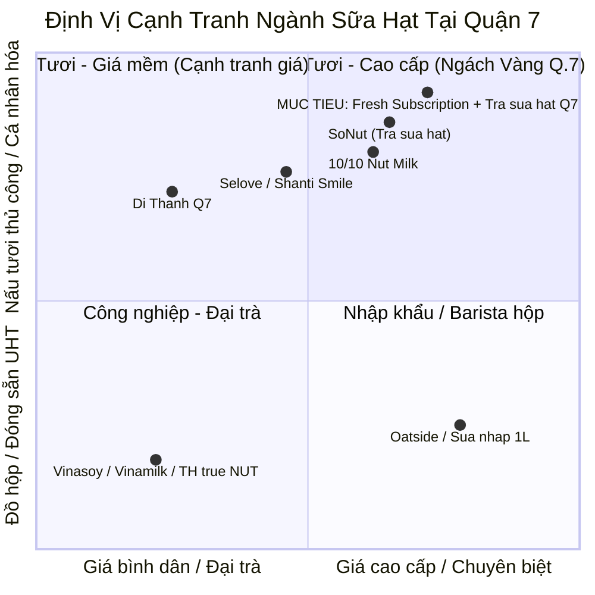

# Nghiên Cứu Thị Trường Chuyên Sâu: Triển Khai Kinh Doanh Sữa Hạt (Trọng Tâm TP.HCM & Quận 7)

**Bối cảnh triển khai:** Khởi điểm từ khu vực **Quận 7 (trục Tân Mỹ – Phú Mỹ Hưng)**, mở rộng đa kênh TP.HCM  
**Ngày lập báo cáo:** 12/11/2026 · **Đơn vị tiền tệ:** VND (tỷ giá quy đổi tham khảo: 1 USD = 25.000 VND `[ESTIMATE]`)  
**Tài liệu liên quan:** [report.md](file:///d:/UFM%20Doc/Project%20AI/market-research/ufm-q7-3-ideas-2026-11-12/report.md) · [sua-hat-deep-dive.json](file:///d:/UFM%20Doc/Project%20AI/market-research/ufm-q7-3-ideas-2026-11-12/sizing/sua-hat-deep-dive.json)

---

> ## Executive Verdict (Kết Luận Chiến Lược Thị Trường Sữa Hạt)
>
> 1. **Cửa thắng không nằm ở "bán sữa hạt giống ngoài chợ", mà ở 3 đòn bẩy cấu trúc:** Thị trường sữa thay thế Việt Nam tăng trưởng `~9,5%/năm` (nhóm sữa hạt cao cấp đạt `~14%/năm`) `[FACT: kenresearch.com, vietstock.vn]`, nhưng **hơn 80% thị phần sữa hộp đã thuộc về Vinasoy & Vinamilk** `[FACT: vietstock.vn]` và doanh số **máy làm sữa hạt tại nhà (`1–2 triệu VND`) đang bùng nổ** trên Shopee/TikTok Shop `[FACT: metric.vn]`. Người bán mới chỉ thắng khi bán thứ sữa hộp và máy ở nhà không làm tốt bằng: **Sữa hạt tươi đa hạt lọc siêu mịn không tách lớp, tùy biến macro (không đường/high-protein), giao lạnh sáng sớm theo gói tuần**.
> 2. **Bẫy chết người về kênh bán (Đã chứng minh bằng số liệu):** Nếu bán lẻ 1 chai `330ml` qua GrabFood (`38.000đ`) hoặc ShopeeFood (`35.000đ`), sau chiết khấu `22–30%` + khuyến mãi `10%` + đóng gói, bạn chỉ còn lãi đóng góp **`6.600–7.060đ/chai` (`18,6–18,9%`)** — lại bị tính thuế trên *doanh thu trước chiết khấu* `[FACT: shopeefood.vn]`. Ngược lại, **Combo Tuần qua Zalo OA (`32.000đ/chai`)** đem lại **`15.900đ/chai` (`49,7%`) — cao gấp 2,3 lần**.
> 3. **Bếp Cloud Kitchen thắng tuyệt đối so với thuê mặt bằng:** Vận hành từ bếp nhà/trọ quanh Tân Mỹ (chi phí cố định/bán cố định `10 triệu/tháng`) chỉ cần **`32–35 chai/ngày`** để hòa vốn. Nếu thuê mặt bằng mặt tiền Tân Mỹ (`22 triệu/tháng`, tổng định phí `~35 triệu/tháng`), bạn phải bán **`104 chai/ngày`** đều đặn 26 ngày/tháng mới hòa vốn `[ESTIMATE]`.
> 4. **Động cơ tăng trưởng kép tại Quận 7:** Neo tệp khách trả tiền cao là **dân văn phòng, mẹ bầu & cư dân Phú Mỹ Hưng (`30.000–40.000` dân)** `[FACT]`, đồng thời mở thêm dòng **"Trà sữa hạt / Matcha hạt / Cà phê sữa hạt"** (học theo mô hình SoNut đạt `4,8–4,9★`) để kéo tệp Gen Z/sinh viên UFM & TĐT sang tiêu dùng lặp lại!

---

## 1. Quy Mô, Tăng Trưởng & Cấu Trúc Ngành Sữa Hạt Việt Nam

### 1.1. Bức tranh vĩ mô & Hành vi chuyển dịch sang thực vật
- **Quy mô ngành sữa thực vật Việt Nam:** Theo dữ liệu Euromonitor (trích dẫn thứ cấp), tổng thị trường đồ uống thực vật Việt Nam đạt **`5.213,7 tỷ VND` (2024)** và **`5.110,5 tỷ VND` (2025)** `[FACT]` — trong đó sữa đậu nành truyền thống chiếm áp đảo (`4.914,6–5.014,9 tỷ VND`), còn nhóm sữa hạt khác (hạnh nhân, óc chó, yến mạch...) ở kênh thống kê chính thức đạt **`195–198 tỷ VND`** `[FACT]`. Theo **Ken Research (2024)**, tổng thị trường thay thế sữa tại Việt Nam đạt **`148 triệu USD` (~`3.700 tỷ VND`)** với **CAGR `9,5%/năm`** `[FACT: kenresearch.com]`; riêng phân khúc **sữa hạnh nhân** đạt **`64,49 triệu USD` năm 2025** theo IMARC Group `[FACT: imarcgroup.com]`.
- **Tốc độ phân hóa theo phân khúc:** Trong khi sữa đậu nành truyền thống bão hòa, **nhóm sữa hạt cao cấp (hạnh nhân, óc chó, yến mạch, hạt điều) đạt CAGR `~14%/năm`** `[FACT: vietstock.vn]`.
- **Áp lực từ xu hướng DIY (Máy làm sữa hạt) trên TMĐT:** Theo Metric.vn & YouNet ECI, tổng GMV 4 sàn TMĐT Việt Nam 2025 đạt **`430.000–458.000 tỷ VND`** (+26–34% YoY) và 6T/2026 tăng **>44% YoY** (Shopee chiếm `55–57,5%`, TikTok Shop `~39,6%`) `[FACT]`. Đáng chú ý, mảng **máy làm sữa hạt gia đình** bán rất chạy ở tầm giá **`1.000.000 – 2.000.000 VND`** (Joyoung, Gilux, Unie, Ostmars, Bear; Shopee giữ >80% thị phần) `[FACT: metric.vn]`. Điều này có nghĩa là **người tiêu dùng rất thích uống sữa hạt**, nhưng nhóm có nhiều thời gian rảnh đang có xu hướng tự mua máy nấu — đây vừa là tín hiệu xác thực cầu (demand validation), vừa là đối thủ thay thế trực tiếp đòi hỏi người bán sữa tươi phải vượt trội về **độ mịn, công thức phối nhiều hạt đắt tiền và sự tiện lợi không cần dọn rửa**.
- **Độ sẵn sàng chuyển đổi:** Khảo sát xu hướng tiêu dùng cho thấy **`66% – gần 80%`** người tiêu dùng Việt Nam sẵn sàng ưu tiên thực phẩm nguồn gốc thực vật vì 4 động cơ chính: *(1)* kiểm soát cân nặng/tim mạch/tiểu đường, *(2)* không dung nạp lactose, *(3)* lối sống xanh/ăn chay, *(4)* thích trải nghiệm hương vị hạt mix béo bùi thay vì chỉ uống đậu nành `[FACT: viracresearch.com, vietstock.vn, cimigo.com]`.

### 1.2. Định lượng TAM / SAM / SOM cho dự án Sữa Hạt (từ `tam_calculator.mjs`)

| Cấp độ thị trường | Phương pháp | Giá trị (triệu VND/năm) | Quy đổi / Diễn giải `[FACT]` & `[ESTIMATE]` |
| :--- | :--- | :---: | :--- |
| **TAM (Việt Nam)** | Top-Down `[FACT]` | **`5.110.500`** | `5.110,5 tỷ VND` — Tổng quy mô thị trường sữa thực vật VN 2025 (Euromonitor) |
| **SAM (TP.HCM — Ngách Sữa hạt ngoài đậu nành & tươi)** | Top-Down `[EST]` (`3,5%` TAM) | **`178.867,5`** | `~178,87 tỷ VND/năm` — Phân khúc sữa hạt cao cấp/tươi khả dụng tại TP.HCM |
| **Local SAM (Cụm Nam Sài Gòn / 3 km quanh 27 Tân Mỹ, Q.7)** | Bottom-Up `[EST]` | **`41.472,0`** | `~41,47 tỷ VND/năm` (`120.000` người trưởng thành bán kính 3km × `15%` ICP uống định kỳ × `6 chai/tháng × 12 × 32.000đ`). Tương đương `~23,2%` SAM toàn TP.HCM |
| **SOM Năm 1 — Conservative (`0,65×`)** | Reconciled `[EST]` | **`534,8 – 539,1`** | `~44,6 – 44,9 triệu VND/tháng` (`~53` chai/ngày × `26` ngày) |
| **SOM Năm 1 — Base (`1,0×`)** | Reconciled `[EST]` | **`822,8 – 829,4`** | `~68,6 – 69,1 triệu VND/tháng` (`~82` chai/ngày × `26` ngày, chiếm `2,0%` Local SAM Q.7) |
| **SOM Năm 1 — Optimistic (`1,4×`)** | Reconciled `[EST]` | **`1.151,9 – 1.161,2`** | `~96,0 – 96,8 triệu VND/tháng` (`~115` chai/ngày × `26` ngày) |
| **Triển vọng 3 năm (CAGR `9,5%`)** | Top-Down `[FACT]` | **`TAM: 6.709.741`** | TP.HCM SAM sau 3 năm đạt **`234.841 triệu VND`** (~`234,8 tỷ VND/năm`) |

---

## 2. Phân Tích Đối Thủ 3 Tầng & GTM Battlecards

### 2.1. Bản đồ đối thủ quanh Quận 7 & Toàn thị trường `[FACT]`

| Tầng cạnh tranh | Tên thương hiệu / Nhóm | Địa bàn / Kênh | Giá niêm yết (VND) | Điểm mạnh | Điểm yếu khai thác được |
| :--- | :--- | :--- | :--- | :--- | :--- |
| **Trực tiếp (Q.7)** | **Sữa Hạt 10/10 (Nut Milk To Go)** | Phạm Thái Bường, P. Tân Phong (PMH) | `20.000 – 45.000đ` | Nằm ngay lõi Phú Mỹ Hưng, vị thanh mát ít ngọt, hợp văn phòng & ăn chay | Thiên mô hình bán lẻ to-go tại quầy/app, chưa thấy đẩy mạnh gói liệu trình cá nhân hóa giao tận căn hộ |
| **Trực tiếp (Q.7)** | **Selove Milk** | ShopeeFood / GrabFood Q.7 | `20.000 – 40.000đ` | Định vị xanh-sạch, có **thu hồi tái sử dụng vỏ chai**, sữa sánh mịn | Phụ thuộc app giao đồ ăn, mất phí hoa hồng sàn cao trên mỗi đơn lẻ |
| **Trực tiếp (Q.7)** | **Tiệm Sữa Shanti Smile** | 83A Đường số 21, P. Tân Quy, Q.7 | `25.000 – 50.000đ` | Quán Yêu Thích trên ShopeeFood; bán kèm sữa tươi & trà sữa kéo tệp trẻ | Menu dàn trải (vừa sữa hạt vừa trà sữa thông thường), thiếu định vị chuyên gia dinh dưỡng/eat-clean |
| **Trực tiếp (Q.7)** | **Dì Thanh Sữa Đậu Nành & Sữa Hạt** | Đường 41, P. Tân Quy, Q.7 | Phân khúc bình dân | Giá mềm, quen thuộc với cư dân địa phương | Hạt truyền thống (đậu nành), chưa mạnh về dòng hạt cao cấp/ít đường/macro cho mẹ bầu & gym |
| **Trực tiếp (Phủ Q.7)** | **SoNut (Sữa Hạt & Trà Sữa Hạt)** | Trụ sở Q.3, giao Q.7 qua ShopeeFood / Grab / Be | `25.000 – 55.000đ/ly` | Điểm đánh giá cực cao (`4,8–4,9/5★`), signature **Trà sữa hạt, Ôlong hạnh nhân, Nut Matcha Latte** cuốn giới trẻ, không đường ngô/sữa đặc | Ship từ trung tâm sang Q.7 tốn phí/thời gian; khách được nhắc phải uống trong **2 tiếng** do không bảo quản |
| **Gián tiếp (Công nghiệp)** | **Vinasoy (Veyo) / Vinamilk (9 loại hạt) / TH true NUT / Oatside** | Siêu thị, Circle K, WinMart+, Shopee Mall | `35–55k`/lốc 4×180ml (`9–14k`/hộp); Oatside `65–110k`/1L | Cực rẻ, để được nhiều tháng ở nhiệt độ thường, độ phủ mọi ngõ ngách | Uống không có độ sánh tươi mới tự nhiên, xử lý UHT mất mùi hạt tươi, có chất nhũ hóa/ổn định |
| **Thay thế (DIY)** | **Máy làm sữa hạt (Joyoung, Unie, Gilux, Bear)** | Shopee / TikTok Shop | `1.000.000 – 2.000.000đ`/máy | Nấu 1 lần rẻ về lâu dài, tự kiểm soát 100% nguyên liệu | Tốn thời gian ngâm hạt 4–8h, cọ rửa cối dao cực ngại, tiếng ồn lớn, phải mua 5–7 loại hạt tồn kho dễ mốc |

### 2.2. Battlecards đối đầu trực diện

#### Battlecard 1: Đấu với Sữa Hạt Đóng Hộp Công Nghiệp (Vinamilk / TH true NUT / Veyo)
- **Target ICP & Positioning:** Nhắm khách đại chúng muốn tiện lợi, giá rẻ (`9.000–14.000đ/hộp 180ml`) `[FACT]`.
- **Why They Win:** Rẻ hơn `2–3 lần`, để tủ/bàn làm việc nhiều tháng không hư, mua ngay tại cửa hàng tiện lợi.
- **Where They Bleed (Friction):** Hương vị công nghiệp (UHT mất hương thơm tươi), chứa chất ổn định/hương liệu/tạo ngọt tổng hợp, hàm lượng hạt thật trên mỗi hộp thường thấp hơn sữa nấu đặc thủ công.
- **How We Win (Wedge):** Không cạnh tranh giá trên phân khúc sữa đậu nành rẻ tiền. Đánh vào **chứng minh trực quan tỷ lệ hạt thật (`100g–120g hạt/lít`)**, nấu mỗi sáng không chất bảo quản, phục vụ tệp **mẹ bầu tiểu đường thai kỳ & gym** — nhóm sẵn sàng trả `32.000đ` vì sự an tâm dinh dưỡng thật.
- **Landmines / Rebuttal:** *Đối thủ nói sữa tươi handmade dễ nhiễm khuẩn/nhanh hư.* $\rightarrow$ **Phản đòn:** Công khai phiếu kiểm nghiệm định kỳ chuẩn ISO 17025 + bản Tự công bố NĐ 15/2018 + dán tem ngày/giờ nấu trên cổ chai kèm hướng dẫn bảo quản lạnh `0–4°C`.

#### Battlecard 2: Đấu với Các Shop Sữa Hạt Trên App Tại Q.7 (Selove, 10/10, SoNut)
- **Target ICP & Positioning:** Đặt giao ngay qua ShopeeFood/GrabFood khi lên cơn thèm (`25.000–55.000đ`) `[FACT]`.
- **Why They Win:** Đã có sẵn hàng trăm đánh giá `4,8–4,9★` trên app; riêng SoNut đánh trúng thị hiếu Gen Z bằng **Trà sữa hạt** `[FACT: grab.com]`.
- **Where They Bleed:** Phí ship `15.000–25.000đ`/đơn lẻ khiến khách muốn uống mỗi sáng phải trả gần `50.000–60.000đ/chai`; giao trễ giờ cao điểm hoặc không bọc giữ lạnh làm sữa chua/loãng đá; không tối ưu cho khách đặt định kỳ cả tuần.
- **How We Win (Wedge):** Tối ưu **mô hình "Giao Sáng Tận Cửa Trước 8h00 (Combo Tuần 5–6 chai, Freeship 3 km từ Tân Mỹ)"**. Người mua trả `~32.000đ/chai` (rẻ hơn tổng bill đặt app mỗi ngày tới `30–40%`) và luôn có sẵn sữa lạnh uống trước khi đi làm! Đồng thời học ngay công thức menu kép: **Sữa hạt thuần không đường (cho PMH/Mẹ bầu/Gym) + Trà sữa hạt / Matcha hạt (cho SV UFM/TĐT)**.

#### Battlecard 3: Đấu với Máy Làm Sữa Hạt Tại Nhà (`1–2 triệu VND`)
- **Why They Win:** Tính kinh tế dài hạn nếu gia đình tự nấu đều đặn.
- **Where They Bleed:** Ngại nhất 3 khâu: **ngâm đãi hạt 4–8 tiếng, tiếng ồn máy xay sáng sớm, và cọ rửa cối dao/lọc xác**, cộng thêm mua 5–6 túi hạt lẻ để lâu bị hôi dầu/mọt.
- **How We Win (Wedge):** Định vị *"Tươi như nhà nấu, nhàn như mở tủ lạnh"* — bán sẵn **Set Mix 5–7 loại hạt** đa dạng mỗi ngày (Thứ 2 Óc chó–Hạnh nhân, Thứ 4 Đậu gà High-protein, Thứ 6 Hạt sen–Bí đỏ) mà ở nhà mua lẻ rất tốn kém và dễ chán vị.

---

## 3. Thấu Hiểu Khách Hàng (Consumer Insights, VoC & Personas)

### 3.1. Phân tích Tiếng nói Khách hàng (VoC) — Tại sao khách mua và tại sao họ cho 1★? `[FACT]`

| Nhóm tín hiệu | Bằng chứng thực tế từ Shopee / GrabFood / Threads / TikTok | Ý nghĩa thiết kế sản phẩm & vận hành |
| :--- | :--- | :--- |
| **1★: Sữa chua, thiu, nhớt khi mở nắp** | Xảy ra nhiều khi giao nắng nóng, không giữ lạnh `0–4°C` hoặc quy trình chai lọ không tiệt trùng `[FACT: cukcuk.vn]` | Bắt buộc dùng **túi giữ nhiệt + đá gel** mọi đơn, tiệt trùng chai PET/thủy tinh trước chiết rót, không bán hàng tồn quá 48h |
| **1–2★: Tách lớp, lắng cặn, lợn cợn** | Khách chê sữa phân 2 tầng (nước trong trên, cặn đặc dưới), uống khé cổ tưởng bị pha loãng `[FACT]` | Phải **rây lọc siêu mịn 2 lần** (hoặc máy xay công nghiệp tốc độ cao), dặn khách *lắc đều trước khi uống* ngay trên tem nhãn |
| **1–2★: Ngọt gắt hoặc nhạt như nước** | Lệch vị giữa các mẻ nấu thủ công; dùng đường mía/đường tinh luyện gây gắt cổ | Dùng cân tiểu ly chuẩn hóa định lượng gam hạt + nước (`100–120g hạt/lít`), tạo ngọt tách riêng bằng **chà là / cỏ ngọt / gói đường phèn rời** |
| **Phốt Threads/TikTok: "Pha đậu nành giả óc chó"** | Nhiều shop quảng cáo hạt cao cấp nhưng độn phần lớn đậu nành + hương liệu `[FACT]` | Minh bạch **tỷ lệ % hạt trên nhãn** và quay video quy trình cân hạt thật mỗi sáng (`"Show, don't tell"`) |
| **Phốt giao hàng: Rò rỉ nắp, vỡ chai, giao trễ sáng** | Shipper giao trễ sau 8h30 khiến dân văn phòng không kịp ăn sáng; chai thủy tinh dễ vỡ khi gửi xa | Giai đoạn đầu dùng **chai PET dày có nắp khóa seal chống tràn** (bền nhẹ khi ship app) hoặc chai thủy tinh riêng cho khách Subscription Q.7 |

### 3.2. Phân khúc Khách hàng & Tệp Beachhead Tại Quận 7 (STP)

| Phân khúc | Nhu cầu cốt lõi (JTBD) | Ngưỡng giá chấp nhận (VND) | Độ lặp lại | Mức ưu tiên |
| :--- | :--- | :---: | :---: | :---: |
| **1. Mẹ bầu & Mẹ sau sinh (Chung cư PMH, Tân Mỹ)** | Bổ sung Omega-3, lợi sữa, **không đường tăng cân / không tiểu đường thai kỳ**, an toàn tuyệt đối `[FACT]` | `35.000 – 45.000đ` / 330ml; `75.000 – 110.000đ` / 1L | Rất cao (mua gói tuần/tháng) | **#1 (Beachhead)** |
| **2. Dân văn phòng (Khu TM Tài chính PMH, KCX Tân Thuận)** | Bữa sáng/xế nhanh sạch, đỡ buồn ngủ, giữ dáng; ngại đặt app tốn ship từng ngày `[FACT]` | `30.000 – 38.000đ` / 330ml (Combo `5–6` chai/tuần) | Cao (3–5 buổi/tuần) | **#1 (Beachhead)** |
| **3. Người tập Gym / Yoga / Pilates (Q.7)** | Nguồn **High-Protein thực vật** phục hồi cơ, ghi rõ **số gram đạm & calo** trên chai `[FACT]` | `32.000 – 42.000đ` / 330–500ml | Cao (sau buổi tập) | **#2 (Mở rộng B2B)** |
| **4. Sinh viên UFM / Tôn Đức Thắng / RMIT** | Đồ uống healthy hợp mốt, ngon miệng (Trà sữa hạt, Matcha hạt), **giá vừa túi tiền** `[FACT]` | `20.000 – 32.000đ` / ly hoặc chai | Trung bình (dễ chuyển sang trà sữa nếu đắt) | **#3 (Kéo bằng dòng Trà sữa hạt)** |

---

## 4. Kinh Tế Kênh Bán (Channel Unit Economics), Giá Vốn & Công Nghệ Bảo Quản

### 4.1. Cấu trúc Giá Vốn (BOM Costing) cho 1 chai `330ml` `[FACT / Benchmark]`
Dựa trên khảo sát giá sỉ các loại hạt tại TP.HCM (Chợ Lớn, Bình Tây, kho hạt Thủ Đức/Tân Bình) `[FACT]`:
- **Giá nguyên liệu sỉ:** Hạnh nhân Mỹ `220–260k/kg`, Óc chó `240–320k/kg`, Mắc ca Úc `320–450k/kg`, Hạt điều Bình Phước `180–220k/kg`, Yến mạch `45–75k/kg`, Đường phèn/thốt nốt `35–60k/kg` `[FACT]`.
- **Công thức chuẩn đậm đặc 1 lít (`= 3 chai 330ml`) với `100g` mix 5 hạt cao cấp** (20g hạnh nhân + 20g óc chó + 20g mắc ca + 20g hạt điều + 20g yến mạch + tạo ngọt tự nhiên):
  - Tiền hạt & gia vị cho 1 lít = `23.400đ` $\rightarrow$ **`7.800đ / chai 330ml`** `[FACT/Benchmark]`.
  - Chai PET dày chuyên dụng (`2.200–2.500đ`) + Nắp, tem, màng co (`1.000đ`) = **`3.300đ / chai`** `[FACT: baobixanh.com.vn]`.
  - **Giá vốn trực tiếp (BOM):** **`11.100đ / chai 330ml`** (Cộng điện, nước RO, gas, hao hụt nấu `~1.900đ` $\rightarrow$ **Full Cost thực tế = `13.000đ / chai`** `[ESTIMATE]`).
- *Chiến lược tối ưu giá vốn:* Nếu thiết kế thêm dòng **"Sữa hạt phổ thông / Trà sữa hạt"** dùng nền Đậu nành Non-GMO + Đậu đen + Gạo lứt + Hạt điều (tỷ trọng hạt nhập ít hơn), Full Cost chỉ còn **`~7.500–9.000đ/chai`**, đủ sức bán giá **`22.000–28.000đ`** cho sinh viên UFM mà vẫn giữ biên gộp `>60%` `[ESTIMATE]`!

### 4.2. So sánh Hiệu quả Lợi nhuận Theo Từng Kênh Bán (Đơn vị: VND / 1 chai `330ml` mix cao cấp)

Tính toán xác định theo mức chiết khấu thực tế tại TP.HCM năm 2025–2026 (GrabFood `25–30%`, ShopeeFood `22–27%`) `[FACT: validator.vn]`:

| Kênh bán hàng | Giá niêm yết | Chiết khấu sàn + Promo (`%`) | Bao bì ship / giữ lạnh thêm | Full COGS (`BOM + điện/hao hụt`) | **Lãi đóng góp trước định phí & thuế** | **Biên đóng góp (`%`)** | Đánh giá chiến lược |
| :--- | :---: | :---: | :---: | :---: | :---: | :---: | :--- |
| **GrabFood** *(Lẻ 1 chai)* | `38.000` | `-14.440` (`28% + 10%`) | `-3.500` | `-13.000` | **`+7.060đ`** | **`18,6%`** | **Chỉ dùng làm phễu kéo khách mới** (tăng giá trên app để bù phí) |
| **ShopeeFood** *(Lẻ 1 chai)* | `35.000` | `-11.900` (`24% + 10%`) | `-3.500` | `-13.000` | **`+6.600đ`** | **`18,9%`** | **Kênh phễu/review**, chèn QR kéo sang Zalo ở lần mua 2 |
| **Zalo OA Direct** *(Combo tuần 6 chai)* | `32.000` | `-1.600` (`0% + 5% KM`) | `-1.500` | `-13.000` | **`+15.900đ`** | **`49,7%`** | **KÊNH CHỦ LỰC:** Lãi gấp **2,3×** app, khóa đơn trước -> `0%` tồn kho hỏng |
| **B2B Bỏ sỉ Gym / Cafe** *(Đơn `>= 20` chai)* | `22.000` | `0` | `-500` | `-13.000` | **`+8.500đ`** | **`38,6%`** | **ĐÒN BẨY SCALE:** Lãi hơn bán app lẻ, đẩy sản lượng nền ổn định |

> **Phép thử Điểm Hòa Vốn (`Break-Even`) giữa 2 mô hình vận hành `[ESTIMATE]`:**
> - **Bếp Cloud Kitchen (Tận dụng bếp nhà quanh Tân Mỹ, định phí `10 triệu/tháng`):** Với cơ cấu kênh `60% Zalo + 25% App + 15% B2B` (sau trừ ước tính thuế khoán/TMĐT `1,5% – 4,5%`), lãi đóng góp bình quân đạt **`11.083 – 12.043đ/chai`**. Điểm hòa vốn chỉ từ **`831 – 903 chai/tháng` (`32,0 – 34,7 chai/ngày`)**!
> - **Thuê mặt bằng đường Tân Mỹ (`22 triệu/tháng` + nhân sự/điện nước = `35 triệu/tháng`):** Điểm hòa vốn vọt lên **`2.704 chai/tháng` (`104,0 chai/ngày`)** — áp lực cực lớn nếu gặp tuần mưa hoặc tháng sinh viên nghỉ hè!

### 4.3. Lựa chọn Công nghệ Bảo quản theo Quy mô
1. **Giai đoạn Khởi nghiệp (`< 150 chai/ngày`, vốn `15–25 triệu`):** Không đầu tư dây chuyền thanh trùng tốn hàng trăm triệu. Nấu mẻ mới mỗi sáng sớm (`4h30–6h30`) bằng máy công suất lớn + nước RO, tiệt trùng chai lọ bằng máy sấy/hấp, làm lạnh nhanh trong tủ mát chuyên dụng `2–4°C` (`shelf-life 2–3 ngày`) `[FACT: fptshop.com.vn]`, giao hết trong ngày theo đơn Pre-order để tỷ lệ hủy hỏng `< 3%`.
2. **Giai đoạn Mở rộng B2B / Chuỗi (`> 300 chai/ngày`):** Khi cần kéo hạn dùng lên **`7–14 ngày`** để ký gửi siêu thị mini/chuỗi cafe rộng khắp TP.HCM, mới nâng cấp lên hệ thống **thanh trùng HTST (`72–85°C` trong `15–30s`) + làm lạnh sốc `< 4°C` + đồng hóa áp lực cao (`100–250 bar`)** để triệt tiêu tách lớp, kèm chuỗi cung ứng lạnh liên tục `2–6°C` `[FACT]`.

---

## 5. Rào Cản Pháp Lý, An Toàn Thực Phẩm & Thuế (Cập Nhật 2025–2026)

1. **Bắt buộc Tự công bố & Kiểm nghiệm sản phẩm (`Nghị định 15/2018/NĐ-CP`):**
   - Sữa hạt đóng chai/hộp sẵn thuộc nhóm thực phẩm đã qua chế biến bao gói sẵn $\rightarrow$ **bắt buộc kiểm nghiệm mẫu** tại phòng thí nghiệm đạt chuẩn ISO 17025 (Quatest 3, Eurofins, Viện Pasteur...) và làm **Bản tự công bố sản phẩm** trước khi phân phối thương mại `[FACT: giayphepthucpham.vn, congtyluatacc.vn]`.
   - Chi phí kiểm nghiệm cơ bản (vi sinh, kim loại nặng, lý hóa): **`1,5 – 3,5 triệu VND/mẫu`** (phiếu có hiệu lực `12 tháng`; nộp hồ sơ tự công bố không mất lệ phí nhà nước) `[FACT: giayphepthucpham.vn, nutrihealth.com.vn]`. *Lưu ý:* Hộ kinh doanh nhỏ lẻ có thể được miễn giấy chứng nhận cơ sở đủ điều kiện ATTP (ký cam kết an toàn theo phân cấp địa phương), nhưng **không được miễn tự công bố & kiểm nghiệm** `[FACT]`.
2. **Tuân thủ Thuế Hộ kinh doanh & Sàn TMĐT (2025–2026):**
   - Ngưỡng doanh thu chịu thuế GTGT & TNCN là từ **`100 triệu VND/năm` trở lên** (tính gộp doanh thu trực tiếp + online) `[FACT: congtyluatacc.vn]`.
   - Từ giữa 2025–2026, các sàn như **GrabFood & ShopeeFood có trách nhiệm khấu trừ, kê khai và nộp thuế thay** cho hộ kinh doanh trên nền tảng `[FACT: shopeefood.vn]`. Đặc biệt lưu ý: **Doanh thu tính thuế được tính trên tổng giá trị giao dịch thành công TRƯỚC khi trừ hoa hồng sàn `20–30%`** `[FACT: shopeefood.vn]`. Do đó khi định giá trên GrabFood/ShopeeFood, bắt buộc phải cộng ngược hệ số sàn + thuế để không bị âm biên lợi nhuận.
3. **Kỷ luật Nhãn mác & Quảng cáo:**
   - Không ghi công dụng mang tính điều trị bệnh (*"trị tiểu đường, giảm cân cấp tốc"*) vì dễ bị xử phạt quảng cáo sai sự thật và mất lòng tin nhóm khách tri thức trên Threads/TikTok `[FACT]`. Thay vào đó, ghi rõ: **Thành phần hạt nguyên chất, ngày sản xuất – hạn sử dụng (48–72h lạnh), và bảng ước tính Calories / Protein / Đường (0g hoặc ít đường)** — đây là điểm chuyển đổi cực mạnh cho dân Gym và Mẹ bầu.

---

## 6. Chiến Lược Triển Khai Go-to-Market 90 Ngày (Từ Khu Tân Mỹ – Quận 7)

### 6.1. Kiến trúc Danh mục Sản phẩm 3 Tầng (SKU Architecture)
Giữ gọn tối đa **6–7 SKU cốt lõi** trong 60 ngày đầu để tránh tồn nguyên liệu:
1. **Tầng Dòng Dẫn (Traffic Hook — Giá `22.000–28.000đ`):** *Trà sữa hạt truyền thống / Matcha sữa hạt / Cà phê sữa hạt* (tinh bột/hạt điều + trà đậm, phục vụ SV UFM, TĐT & dân văn phòng thích vị béo giải khát thay trà sữa truyền thống).
2. **Tầng Lợi Nhuận Cốt Lõi (Core Margin — Giá `32.000–38.000đ` / `330ml` hoặc `75.000–90.000đ` / `1L`):** *Hạnh nhân – Óc chó – Mắc ca ít ngọt*; *Mè đen – Hạt sen – Gạo lứt*; *Hạt điều – Yến mạch – Cacao* (bán theo **Combo Tuần 5–6 chai**).
3. **Tầng Chuyên Biệt Giá Cao (High-Value Niche — Giá `38.000–45.000đ`):** *High-Protein Plant Milk* (đậu gà + hạt điều + hạnh nhân, không đường, ghi rõ gam đạm cho phòng Gym/Pilates) và *Mom-Care Milk* (óc chó + mè đen + hạt sen không đường tinh luyện cho mẹ bầu tiểu đường thai kỳ).

### 6.2. Phễu "App Kéo Mới $\rightarrow$ Zalo Khóa Tái Mua $\rightarrow$ B2B Mở Rộng"
1. **Tháng 1 (Chứng minh chất lượng với `15–25 chai/ngày`):**
   - Quay 10–15 video TikTok/Reels ngắn minh bạch: *cận cảnh ngâm rửa, cân đúng 100g hạt thật, rây lọc mịn, dán tem giờ nấu* -> chạy local ads bán kính `2–3 km` quanh Tân Mỹ – Phú Mỹ Hưng.
   - Phát mẫu thử `100ml` tại `3–5` phòng Gym/Yoga/Chung cư Tân Mỹ & nhóm cư dân Phú Mỹ Hưng.
2. **Tháng 2 (Tối ưu Hóa Đơn & Hợp Pháp Hóa):**
   - Hoàn tất kiểm nghiệm mẫu & Tự công bố (khoảng `3–5 triệu VND` cho 1–2 nhóm công thức đại diện, cần hỏi tư vấn phòng kiểm nghiệm để gộp nhóm tiết kiệm chi phí).
   - Mở gian hàng ShopeeFood/GrabFood (đặt giá cao hơn Zalo `15–20%`), gắn thẻ *"Ưu đãi gói Tuần Freeship trước 8h00 qua Zalo OA"* trên cổ mỗi chai để **chuyển đổi khách lẻ trên app thành khách gói tuần trực tiếp** (tăng lãi đóng góp từ `6,6k` lên `15,9k/chai`).
3. **Tháng 3 (Đẩy sản lượng nền B2B lên `60–80+ chai/ngày`):**
   - Ký gửi tủ mát mini / bỏ sỉ (`20.000–23.000đ/chai`) cho 5–10 phòng tập Gym/Pilates, cửa hàng thực phẩm sạch hoặc quán cafe Workspace quanh Tân Mỹ – Phú Mỹ Hưng (bán thêm lựa chọn sữa hạt 1L cho quán cafe làm món *Oat/Almond Latte*).

---

## 7. Khoảng Trống Dữ Liệu (`[UNVERIFIED]`) Cần Thử Nghiệm Thực Địa

1. **Tỷ lệ chuyển đổi thực tế từ đơn lẻ ShopeeFood/GrabFood sang Combo Tuần Zalo OA** tại khu vực Tân Mỹ – PMH (ước tính mục tiêu cần test là `>= 25%` khách mua lại lần 2 chuyển sang Zalo).
2. **Chi phí kiểm nghiệm chính xác theo từng SKU riêng lẻ hay theo nhóm sản phẩm tương đồng** tại Quatest 3 / Eurofins cho công thức của bạn (vì nếu 5 vị phải làm 5 bộ hồ sơ riêng sẽ đội chi phí lên `10–15 triệu` thay vì `3,5 triệu`). *Hành động: gọi trực tiếp phòng tư vấn trung tâm kiểm nghiệm trước khi gửi mẫu.*
3. **Sức tiêu thụ thực tế của dòng "Trà sữa hạt" với sinh viên UFM 27 Tân Mỹ** ở mức giá `25.000–28.000đ` so với các quán trà sữa truyền thống/Góc UFM' (`15–30k`) xung quanh trường.

---

## 8. Danh Mục Nguồn Tham Khảo Bổ Sung

| # | Dữ liệu / Chỉ số | Nhãn | Nguồn & Thời kỳ | Đường dẫn |
| :-: | :--- | :---: | :--- | :--- |
| 1 | Đối thủ Sữa hạt Q.7 (Sữa Hạt 10/10, Shanti Smile, Selove Milk, SoNut `4,8–4,9★`, `20k–55k`) | `[FACT]` | ShopeeFood, GrabFood, Be | [10/10](https://vertexaisearch.cloud.google.com/grounding-api-redirect/AUZIYQGqjX_6-at2f-fgN2CzLMHFBpf8TUOcdMHviYNreU-hAakEaoqyzAx_2LAN7_oNbKZ51PsYsnfPj1SeVLdB9B7kk_Rcm8ureVEgXJy4PHl9fX02RqijsZK6_WspvX0Z2uXiwCMACiyTqQas46SOGCwUrN6l5_u7zX9C3wAupGAhqOCv01UHiw==) · [Shanti Smile](https://vertexaisearch.cloud.google.com/grounding-api-redirect/AUZIYQGIBh9iRfbyJ5WCEy3IHwEu6dyHxIF9g7_Ok_yXUkVPHg2ZslxyJvS3DUU9Pg5TCKu-AjqWuKxGuGH1fV8LZpPjjVuGWoUMMgc_R-UeUZF5tIpJL2C9A1p1EB6BtklobyElLF7HsEjmj8O9Q4iyPPC_pU76zdlClCmxROMu2jsrlvR6zYe9MQ==) · [Selove](https://vertexaisearch.cloud.google.com/grounding-api-redirect/AUZIYQFuMVdr7-o44auJCbze2HFHNKGd4CCPPSAPdpplc4_W01FjOPFQ1EG9PPx4jxzJErg2NmXpiRT7uON1izyIb4zrUtq-d581d89d3afeb7ggZ9B6JGFwMtt2a1RzLZ3_2275Xl71PFIsher04TBuZY1XnC4GDiI=) · [SoNut](https://vertexaisearch.cloud.google.com/grounding-api-redirect/AUZIYQE3cu7FU6CxdigXIgQ_mxgGqzAfRzvzaQ9evl_3oR-3vrYup_2jqgo5TB640Jyul0VpCgSCwpsXr9WY4oaVT-FgoCi2wasbmPD4Acl8TsVTIzsGBAuXXH_YVnWEdOIpLmQtLjQ2PcCigbN_JbHJpicCgpK5C40Fx_cCZ34SKp1NkPzqQSDO3S9eqv17) |
| 2 | Dữ liệu TMĐT 4 sàn VN 2025 (`430–458k tỷ`), H1/2026 (`+44%`), phân khúc máy làm sữa hạt `1–2 triệu` bán chạy nhất (Shopee >80%) | `[FACT]` | Metric.vn, YouNet ECI, Brands Vietnam (2025–2026) | [Metric 2025](https://vertexaisearch.cloud.google.com/grounding-api-redirect/AUZIYQHt9jKKkT6IF3lZtBblphhAEBnXFdDqiNYsSOTjE8BRaYTpjkAXCQu4NmjyLqvMV7znw2cydLsx9R-tVRHuvcf6IPnaGnrgXyHI1Z5Im4TReX8oZ3M1NhmVfI_kCxZ6OWE4C0g78LAIBciHOd6_18NMB45qsOvICd6282NzunDuQ2Kr) · [Metric Máy làm sữa hạt](https://vertexaisearch.cloud.google.com/grounding-api-redirect/AUZIYQGhpmsf8_Ueo97lsZJhYj6-0py5lFbdoNVbWHAkI3B5up7ML44pqlj9xSpvtqRBXg5wQQkbJzcQqOWdZtxJr_6OkurfdbGAWjOn9S-G69w9__k7g-0vIlk=) · [YouNet ECI](https://vertexaisearch.cloud.google.com/grounding-api-redirect/AUZIYQEkwzCF7IPz4f8fijjZz96tp0yVBLsjM14VfCd2YQTsJeK18jFSDrPF0YbvFdWTfhQOEeAHQf99Wh1CAEV4Aa-nf2-9rkiB4N0xgik1g9IPsSQOAvCIyp6DwV2FHqWgqRNO-LMuOtkgsbphUFk-WqbmPjFucg==) |
| 3 | Tỷ lệ người Việt ưu tiên thực phẩm thực vật (`66%–80%`), Vinasoy >56% & Vinasoy+Vinamilk >80% | `[FACT]` | VIRAC, Vietstock, Cimigo | [VIRAC](https://vertexaisearch.cloud.google.com/grounding-api-redirect/AUZIYQGc2s8lpZ1QM8ludQMu3nBNi2ELF-h7iU9YKDtxyrNOFN8TCvX4mtn8ZrdTZMmcCFPtK0PdNY914UbhW4Qlp4fsPBdvgM5cqV9YlirTZjqPnql-b91Lj1aj84VbCyp2s1SAN6XQuqM7SHjRIVhJkFUeIunq2MkaYF81IaEOYQ==) · [Vietstock](https://vertexaisearch.cloud.google.com/grounding-api-redirect/AUZIYQFRQUNIwd39aSAB1h8JS_tl7aSe8NFbL0K2we8CGbaiO_h0uy0Pxx_krkiKWicps2HHE5Z83iy4v41xBwbfY_U9FbIRgdnsx2nY2A9F1r2dpAQlA63y5fAXOtiF1Vm6FypKiGfINQ==) |
| 4 | Chiết khấu GrabFood (`25–30%`), ShopeeFood (`22–27%`), thuế GTGT giảm `8%`, sàn khấu trừ thuế thay & tính trên tổng doanh thu trước chiết khấu | `[FACT]` | Validator.vn, ShopeeFood, Grab, Luật ACC (2025–2026) | [Validator](https://vertexaisearch.cloud.google.com/grounding-api-redirect/AUZIYQHHcHV1D2NY6KCEKaQoiVxZQ39ODVwELb4ipINkNPNU8ym95V2dygETmu5CEkEav_y0bBCJLiGpSbcYDqfE3u4GYR4dnl87Z6UbFVhYg6Qmj5pTy-3xcehYrBwguYS3vjfMmUrKzQdmaEtWqvhRQeUz) · [ShopeeFood Thuế](https://vertexaisearch.cloud.google.com/grounding-api-redirect/AUZIYQGo_mvPloxBzx9vmDajzXEooJuvOCBaoJqjGb280BJ97I2wPaQSSNkANCgBlGHD0rwHKynVGyaLLiOskyMDog-s4RIACimRVg0A7mo65XJ-t1WioHNP2Yu3ml64RgR_6QpHHAH1xkmNuJ6FtNBSI891olK4XdeycscjJTrV1cwDVTIxOHHOiOg7EF9UIVVVZaST4uNenbH6fxmNN2kKW6RxRcZcwd0xMGy8AZh6vhO7HaIHun54cmn56hfP) |
| 5 | Công nghệ thanh trùng (`72–85°C`, lạnh sốc `<4°C`, đồng hóa `100–250 bar`, hạn dùng `7–14 ngày`) & Giá bao bì chai PET | `[FACT]` | FPT Shop, MC Milk, Bao Bì Xanh, Lý Phạm | [MC Milk](https://vertexaisearch.cloud.google.com/grounding-api-redirect/AUZIYQGp4bQcV-uLuvJn9GF7iAg8ZRGSRLwwt9zaTzcar0epwcEoal4YlUKtLTJI9lGMV1W0yZXO8zec5l-dEAoLG1_0zQrSN-hAA6r8W36vOaztZNXk2v-AaiVuKgRwjxRYwXWT1Ar-ikMWmP0r8nHbWVo=) · [Bao Bì Xanh](https://vertexaisearch.cloud.google.com/grounding-api-redirect/AUZIYQFqRi5MWwjudDo1DHfiRbUO5n3m7XQDpF5hspaIPpbX2LF5snnivSEn1nWXacVxSk4oguLS4v0FxVRAWV1XeLZolwKKeePathbmSuF2XDrOrtP0EoRgo1cGcibyJbah3Ism) |
